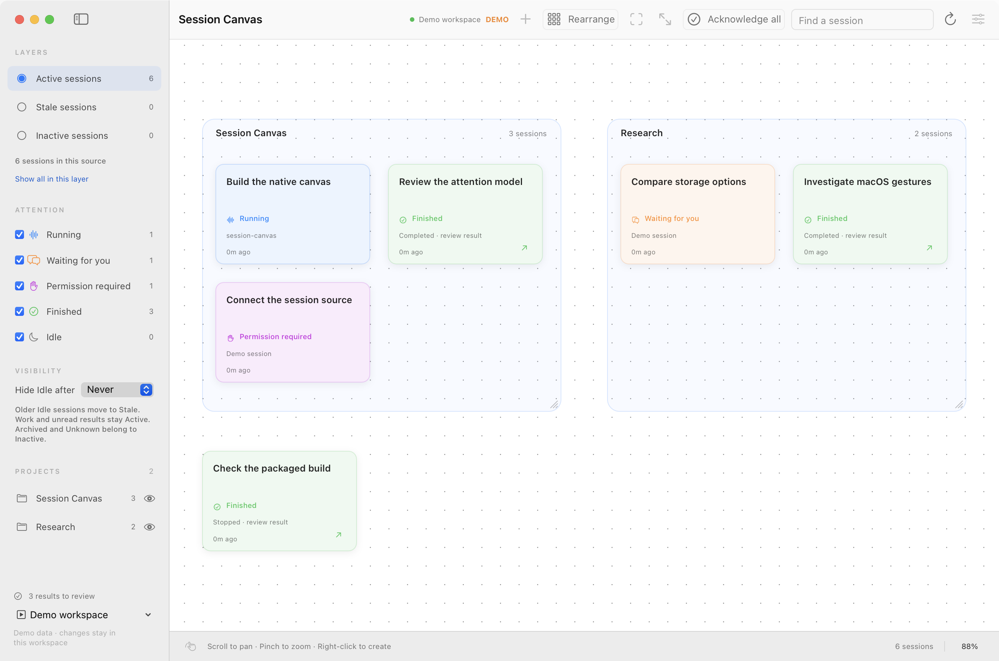
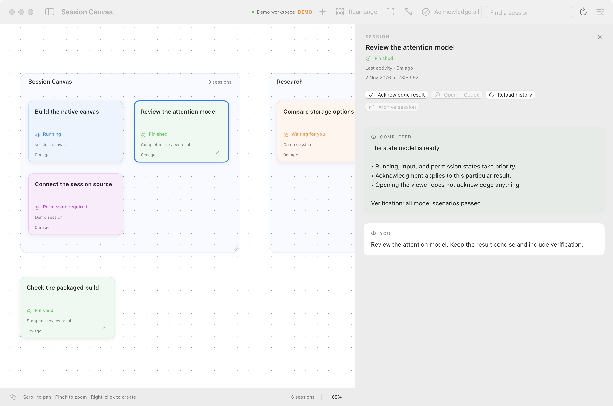

# Session Canvas

**See what your Codex sessions need, all in one place.**

Session Canvas is a native Mac companion for your existing Codex sessions. Keep
them on a canvas, see what is running or waiting for you, and review finished
results without losing track of the rest of your work.

**[Download for Mac](https://github.com/WinnerOK/session-canvas/releases/latest)**
· [Getting started](docs/getting-started.md)
· [Documentation](docs/README.md)
· [Report an issue](https://github.com/WinnerOK/session-canvas/issues)

*The real macOS interface with built-in demo sessions. Both screenshots use
fictional data.*

## Why Session Canvas?

- **Know what needs you.** Distinct labels and colors separate running work,
  questions, permission requests, and results ready to review.
- **Keep your bearings.** Move cards and project regions, pan and zoom, or use
  **Rearrange** to tidy the current layer. Your layout survives reopening.
- **Keep results visible until reviewed.** Opening a session leaves its result
  unread. Acknowledge it when ready, or mark it unread again for later.
- **Focus on current work.** Switch between Active, Stale, and Inactive layers;
  filter by attention state or project, and search session titles.
- **Continue in Codex.** Open the original conversation to reply or approve a
  request. Create an empty session from a project area and continue there.

## Install

You need **macOS 14 or later**, an **Apple Silicon Mac**, and a locally installed,
signed-in **Codex desktop app**. Keep Codex open for live session updates.

1. Download the `SessionCanvas-…-macos-arm64.zip` archive from
   [the latest release](https://github.com/WinnerOK/session-canvas/releases/latest).
2. Unzip it and move **Session Canvas.app** to **Applications**.
3. Open Session Canvas. It connects to your local Codex sessions by default.

This is an early release. Downloads are ad-hoc signed and are not notarized by
Apple; macOS may block the first launch. See [installation help](docs/getting-started.md#install-and-open)
for checksum verification and first-launch guidance.

## Your first minute

1. Start in **Active sessions**. Use **Fit to Content** (⌘0) to see the workspace.
2. Click a session card to read its history and latest result. Scroll to pan and
   pinch to zoom; drag a card or a project header to arrange your workspace.
3. Choose **Acknowledge result** after reviewing a Finished session, or
   **Open in Codex** to continue the conversation.

Want to explore first? Choose **Demo workspace** from the source menu at the
bottom of the sidebar. Its simulated sessions are separate from your Codex data.

## Review results in context

The session viewer keeps the result beside your workspace. History opens newest
first, with older entries available on demand. Opening the viewer never marks a
result as reviewed; **Acknowledge all** marks the latest results of every Finished
session in the current source as reviewed, including hidden cards.

## What to expect

Canvas stores its layout, filters, and review records locally on your Mac.
Replies and permission decisions happen in Codex. Existing sessions must also be
moved between projects **in Codex**; Canvas follows their actual membership.

Integration depends on your installed Codex version. **Unknown** means current
execution could not be verified. See [connection help and current limitations](docs/getting-started.md#connection-and-status-help).

## Documentation and feedback

Start with **[docs/](docs/README.md)** for installation help, controls, data storage,
compatibility, building from source, and development guides. Technical design,
verification history, and OpenSpec specifications are indexed there too.

Found a problem or have an idea? [Open an issue](https://github.com/WinnerOK/session-canvas/issues)
with the app and Codex versions, what you expected, and what happened. Remove
private session content from screenshots and reports.
