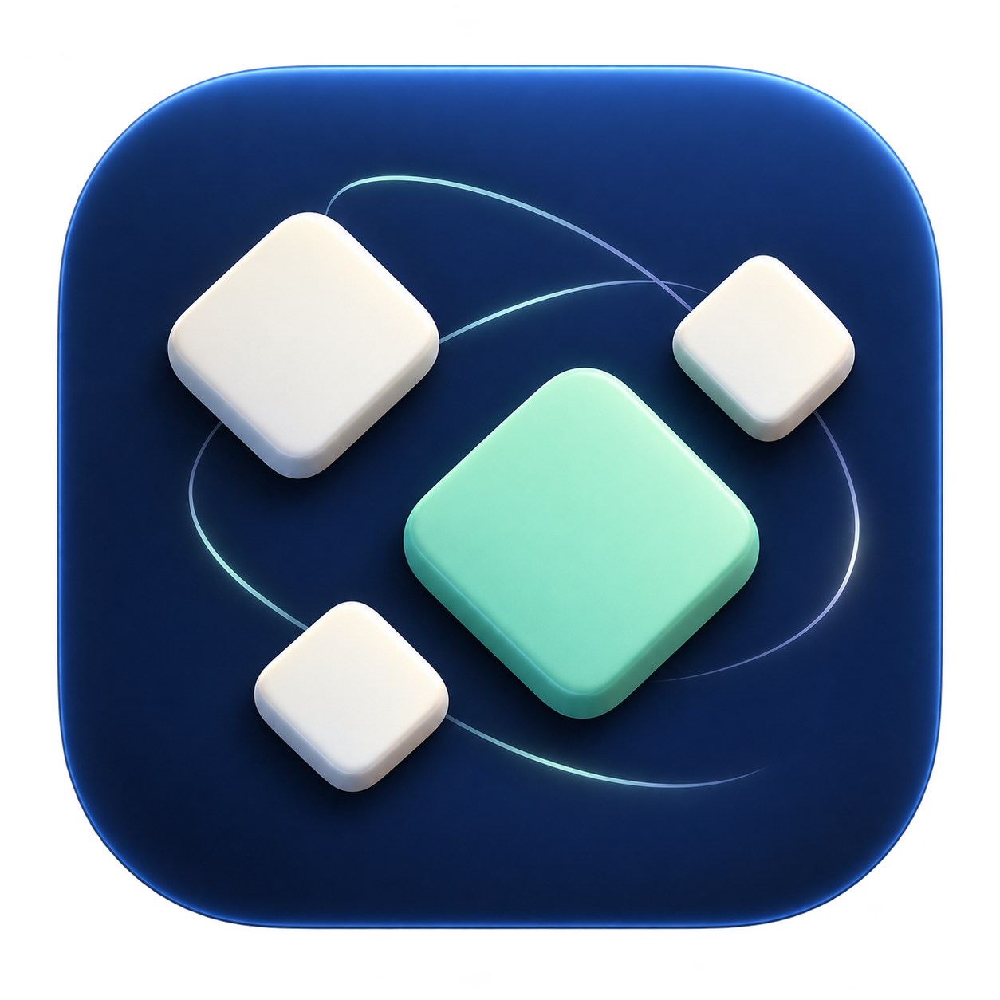
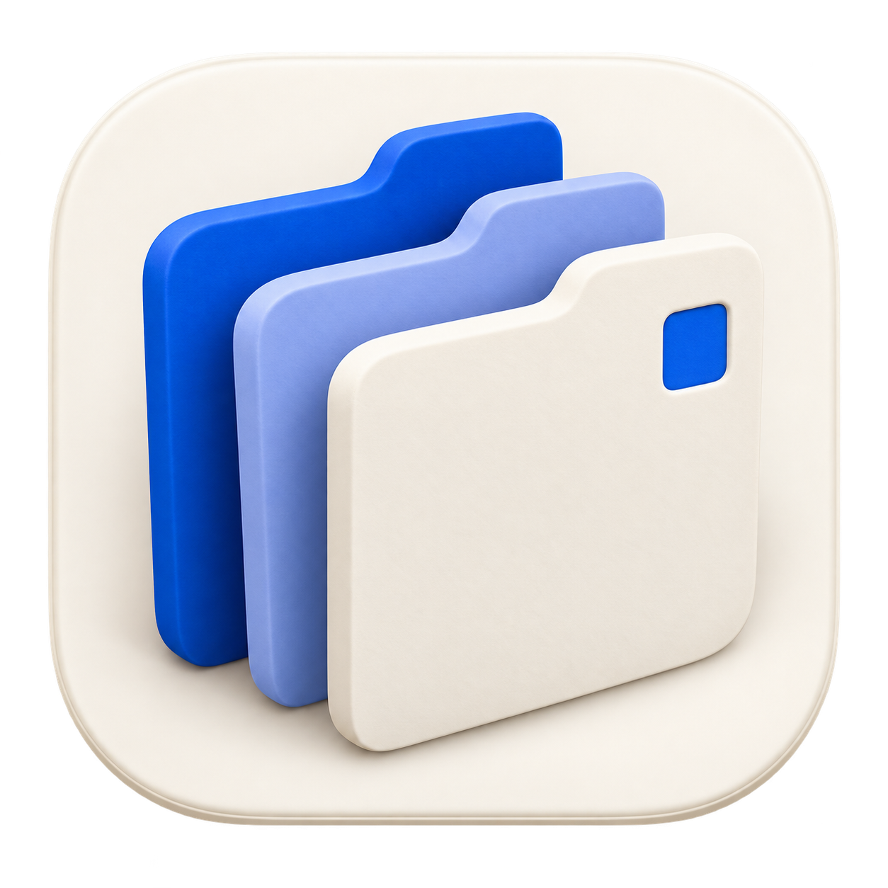
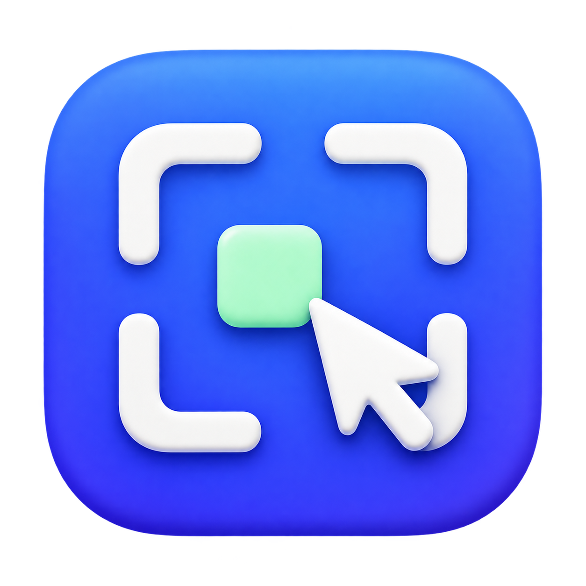

# Four alternative Session Canvas icon concepts

Created with the built-in `image_gen` tool. Each concept is a separate PNG with a transparent exterior. These are visual proposals for review; they are not app-bundle assets and introduce no application behavior changes. Existing OpenSpec requirements and acceptance gates remain applicable.

## 1. Spatial monogram

A broad folded ribbon becomes a sculptural S. The simplest of the four directions, intended as a standalone brand mark.

### Generation prompt

Create a single original macOS app icon for SessionCanvas, a native workspace for arranging AI coding sessions on a spatial canvas. Concept: SPATIAL MONOGRAM. An iconic sculptural S made from one broad folded ribbon, with the elegant curve and open negative space subtly suggesting C as well. The ribbon's three wide planar sections evoke different work surfaces while remaining one exceptionally simple memorable symbol. Porcelain-white ribbon, with restrained cool blue reflected light, raised above a deep cobalt rounded-square tile. Bold, nearly flat front view, precisely controlled geometry, generous negative space, beautifully balanced silhouette, subtle satin depth and soft self-shadowing. This is an abstract brand mark, not a miniature user interface: no cards with text, no little lines, no windows, no status badge. Designed to remain recognizable at 32 pixels. Polished contemporary native Mac developer-tool identity. One icon only, large centered square composition; tile occupies about 86 percent of image width; genuine transparent exterior. No caption, no written name, no typography apart from the abstract S form, no watermark, no mockup, no surrounding scenery, no chrome shine, no stars or sparkles.

## 2. Session constellation

Four session tiles form a spatial constellation, with one mint tile emphasized as the current focus.

### Generation prompt

Create one original polished macOS app icon for SessionCanvas, a native spatial workspace for monitoring multiple AI coding sessions. Concept: SESSION CONSTELLATION. An abstract overhead constellation of exactly four substantial rounded diamond tiles on a deep midnight-blue squircle, arranged asymmetrically with calm generous spacing around a single larger mint-green tile. The larger tile is one of the four, the other three are pearl ivory. The tiles are simple solid small sculptural objects with very shallow ceramic thickness, no writing, no internal UI marks. Two or three elegant very thin gently curved orbital traces pass behind the cluster, suggesting attention moving between sessions, not a technical node graph. The main mint tile is crisply emphasized without neon glow. Feel like a beautifully organized constellation at night: spatial awareness, multiple concurrent sessions, one active focus. Strong sophisticated graphic composition, sharply legible at small icon sizes, almost flat top-down view with very subtle depth. Delicate cool rim on the midnight tile. One app icon only, large and centered; rounded-square tile occupies 86 percent of image width; true transparent exterior. No literal stars, no galaxy photo, no grid of windows, no card text, no letters, no code symbols, no robot, no watermark, no captions, no presentation board or device mockup.

## 3. Session tabs

A set of staggered dividers represents a personal working set of sessions. The light base gives this direction a stationery-like character.

### Generation prompt

Design a single original high-quality native macOS application icon for SessionCanvas, a spatial workspace that organizes existing AI coding sessions. Concept: SESSION TABS / A PERSONAL WORKING SET. A compact sculptural fan of exactly three thick rounded tabbed panels, standing together like an elegant small set of index dividers. Their large staggered tabs step from rear to front, making a memorable rhythmic silhouette. One rear panel is clear cobalt blue, one middle panel soft periwinkle, and the foreground panel warm ivory. The foreground panel is completely blank, with one small crisp blue inset square near its upper corner. The panels fan only slightly, no dramatic perspective, and sit on a warm light-ivory macOS rounded-square base with a very subtle porcelain edge. Sophisticated tactile paper-and-ceramic material, clean big geometric forms, graceful depth, beautifully controlled soft shadows, calm editorial stationery aesthetic. This concept should evoke choosing between separate work sessions and keeping them within reach. Bold icon geometry with no tiny detail, legible in the Dock. Single centered icon, base occupies 86 percent of image width, genuine transparent exterior. No text, no letters, no lines of fake writing, no browser chrome, no folder symbol, no pencils, no binder rings, no stars, no glowing effects, no watermark, no caption, no mockup.

## 4. Direct manipulation

Canvas corner brackets, one session tile, and a pointer emphasize direct manipulation on the spatial workspace.

### Generation prompt

Create one distinctive professional macOS app icon for SessionCanvas, a free-roam workspace in which users place and move their AI session notes. Concept: DIRECT MANIPULATION / THE CANVAS. The graphic is a simple airy square canvas frame made of four bold disconnected white rounded corner brackets, enclosing open space. Within it sits ONE small rounded ivory square positioned slightly off center, representing a session. A bold white standard mouse-pointer arrow overlaps the lower-right part of the frame, visibly pointing into the canvas and suggesting moving the session. Design it as a coherent clever logo with carefully balanced negative space, not a software screenshot. Background is a vivid cobalt-to-indigo macOS squircle with only a very subtle satin gradient. Foreground frame and pointer have minimal raised ceramic relief with clean soft shadows; the little session square has a mint-green surface, providing the single secondary color accent. Confident minimal composition, geometric and almost flat, far fewer details than a typical interface icon; strong readability at 32 pixels. One app icon only, centered, tile occupies about 86 percent of image width, real transparent exterior. No text, no letters, no selection handles, no dot grid, no tiny interface controls, no multiple cards, no code bracket characters, no sparkles, no watermark, no mockup, no caption.
