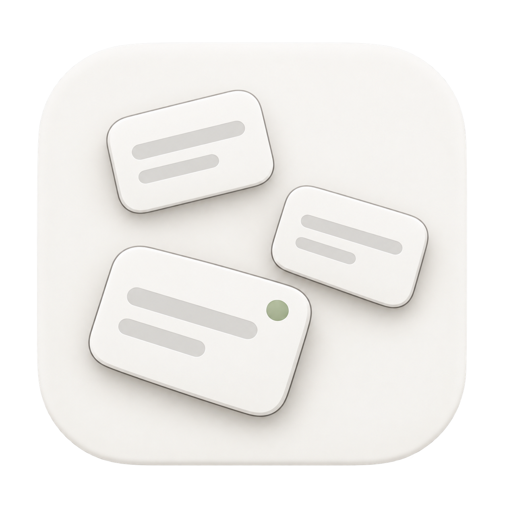
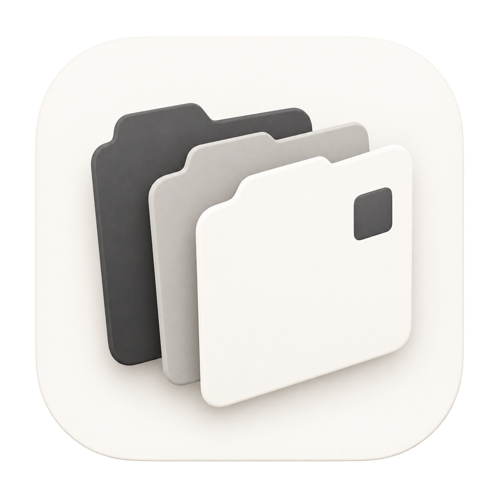
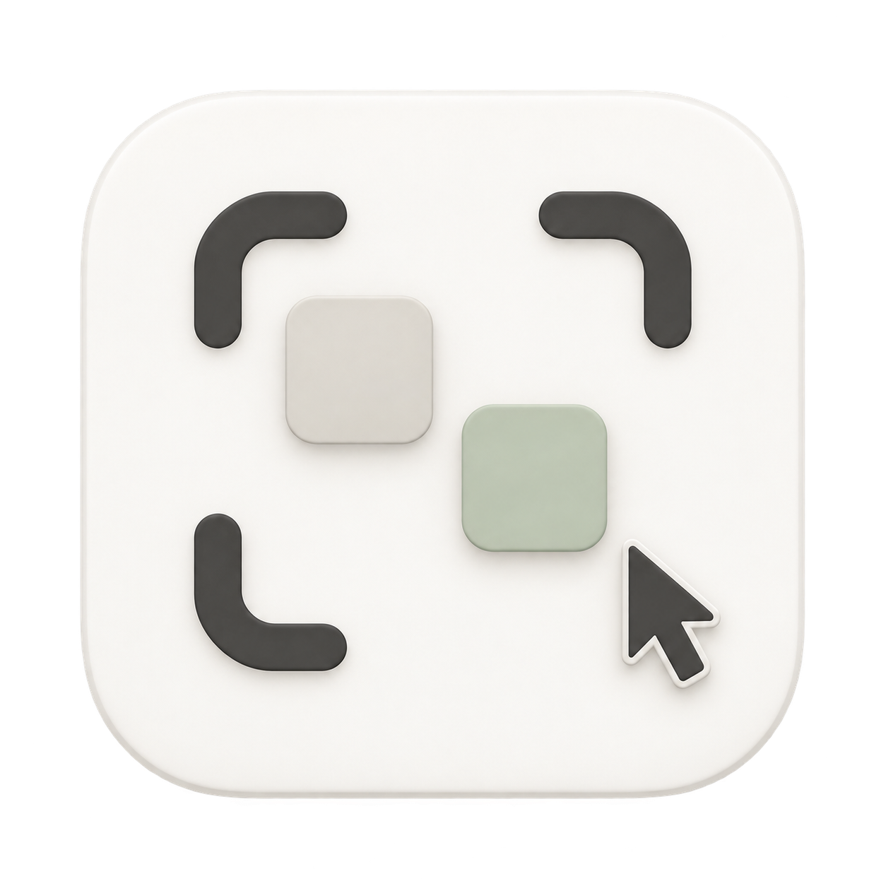

# Light Session Canvas icon alternatives

Created on 2026-10-25 with the built-in `image_gen` tool in response to the request for more variants in a light style inspired by the Codex application. All four PNGs are 1254 × 1254 with an alpha channel and a transparent exterior.

The user selected the original [blue session cards](README.md) for the application. These light alternatives remain saved for comparison and are not used by the app bundle.

## 5. Light session cards

Three white session cards with a muted sage activity mark on a warm-white tile.

### Generation prompt

Use case: logo-brand. Asset type: original macOS app icon for Session Canvas, a personal spatial workspace for arranging AI coding sessions. Primary request: a fresh icon in a LIGHT, restrained visual style inspired by the calm light interface of the Codex desktop app. Subject: exactly three separate small rounded session cards arranged asymmetrically in a spacious loose C on a warm off-white macOS rounded-square tile. Cards are porcelain-white with thin warm graphite edges, one or two broad subtle gray inset strokes, and very shallow relief. One tiny muted sage-green circular status mark on the front card. Style: exceptionally simple contemporary native Mac productivity icon, almost flat, with soft precise shadow and a barely perceptible paper-like bevel, no heavy 3D. Palette: warm white #F5F3EF, ivory, pale warm gray, soft charcoal #353431, one quiet sage accent. Composition: one single large centered icon, straight-on view, tile occupies about 86 percent of the square image, generous uncluttered spacing, clean silhouette readable at Dock size. Exterior genuinely transparent; the rounded tile itself is opaque. No text, no letters, no blue tile, no saturated gradients, no glow, no sparkle, no robot, no OpenAI logo, no watermark, no mockup, no multiple-icon board.

## 6. Light spatial monogram

A graphite folded S on a warm-white tile.

### Generation prompt

Use case: logo-brand. Asset type: original macOS app icon for Session Canvas, a spatial workspace for AI coding sessions. Primary request: a distinctive minimalist LIGHT icon compatible with the quiet warm-white and graphite visual language of the Codex desktop light interface. Subject: a single strong abstract sculptural S built from one broad continuous folded ribbon; its two open spaces gently suggest separate working surfaces. The ribbon is matte warm graphite, with one softly shaded fold, above an opaque warm porcelain-white rounded-square macOS tile. Style: nearly flat, bold editorial symbol, subtle paper-fold dimensionality, extremely restrained edge shading, no glossy 3D. Palette: warm white #F5F3EF, charcoal #353431, delicate warm-gray shadow only. Composition: one isolated centered app icon, straight-on square view, tile occupies about 86 percent of the image, glyph about 58 percent, broad empty margins, large clean forms recognizable at 32 pixels. Real transparent exterior outside the tile. No written name, no captions, no extra letters, no code brackets, no OpenAI logo, no blue, no neon, no chrome, no decorative tiny details, no watermark, no mockup, no multiple-icon board.

## 7. Light working set

Three offset tabbed panels in graphite, stone, and ivory.

### Generation prompt

Use case: logo-brand. Asset type: original macOS application icon for Session Canvas, a workspace for keeping several coding sessions within reach. Primary request: another LIGHT icon direction inspired by Codex's calm light desktop UI, with generous space and restrained neutral materials. Subject: exactly three offset rounded upright tabbed panels, neatly fanned by a small amount like a compact personal working set. The rear panel is matte warm graphite, the middle is pale stone-gray, and the front is creamy white with one single small inset graphite square. All on an opaque warm-white rounded-square macOS icon tile. Panels have minimal thickness, subtle soft edge shadows and clean broad silhouettes; sophisticated flat paper-cut style with only a hint of native-icon relief, NOT a detailed folder illustration. Palette: warm white, bone, stone gray, muted charcoal; no saturated colors. Composition: one single centered icon, almost straight-on view, generous margins, tile occupies about 86 percent of square image, legible at 32 pixels. Exterior fully transparent outside the tile. No text, no fake writing, no blue, no gradients, no glare, no OpenAI logo, no stars, no watermark, no mockup, no multiple-icon board.

## 8. Light focus canvas

Graphite canvas corners, two quiet session tiles, and a pointer.

### Generation prompt

Use case: logo-brand. Asset type: original macOS application icon for Session Canvas, a free-roam canvas for independent AI coding sessions. Primary request: a LIGHT and minimal app icon that belongs beside the Codex desktop light interface. Subject: four short thick warm-graphite rounded corner brackets define a simple open canvas boundary. Inside, exactly two small floating rounded session squares are offset with generous breathing room: one pale stone square and one muted sage-green square. A clean small graphite mouse pointer overlaps the lower-right open corner, suggesting direct manipulation. All placed on an opaque warm porcelain-white macOS rounded-square tile. Style: nearly flat graphic mark with only soft tiny cast shadows and a delicate native-icon bevel; precise simple geometry, strong silhouette, calm and modern. Palette: warm white #F5F3EF, graphite #353431, light warm gray, very quiet sage #C3CEC0. Composition: one isolated large centered app icon, square straight-on view, tile occupies about 86 percent of image, broad empty margins, clarity at 32 pixels. Genuine transparent exterior beyond tile. No text, no letters, no blue tile, no saturated color, no glow, no shiny plastic, no OpenAI logo, no watermark, no mockup, no multiple-icon board.
