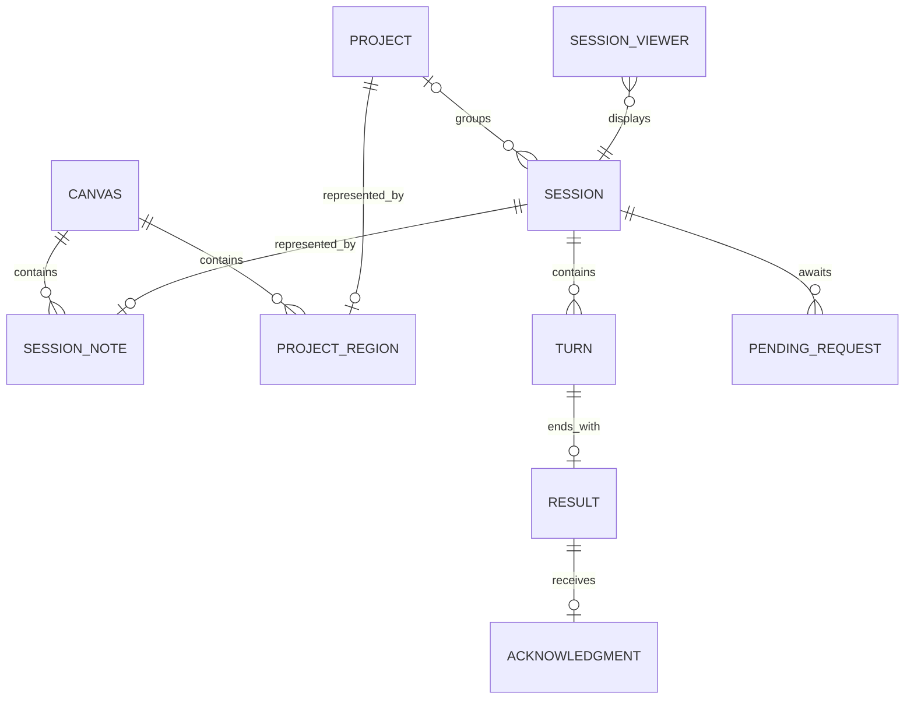
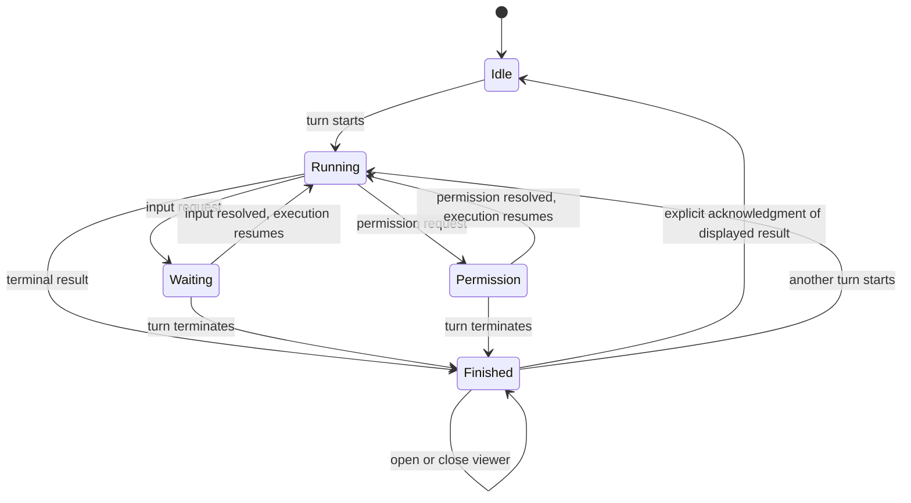

# Session Canvas domain model

## Product intent

Make existing Codex conversations spatially recognizable and make changes that need the user's attention visible. The canvas is an additional way to organize the same sessions, not a second collection of conversations.

Canonical vocabulary lives in [GLOSSARY.md](../GLOSSARY.md). The behavioral contract lives in the [OpenSpec change](../openspec/changes/add-session-canvas/proposal.md).

## Confirmed requirements

The canvas displays exactly one lifecycle layer. Archived and Unknown belong to **Inactive sessions** first, regardless of age or cached unread results. Otherwise eligible Idle sessions at or beyond **Hide Idle after** belong to **Stale sessions**; all remaining sessions belong to **Active sessions**. Never, missing/future activity, execution, requests, and unread results prevent age classification as Stale. Classification ignores search and visibility choices; the clock reevaluates it within 30 seconds. Actual project membership and source facts remain shared across layers.

Each actual project has independently saved region bounds on each populated layer. Region interiors cannot overlap or nest within a layer, including filtered occupied regions; cross-layer coordinates may overlap freely. Moving a region carries only current members of that layer, including filtered members. Departed note positions and empty regions remain remembered without reserving space. Returning sessions restore valid project-relative offsets or receive a free placement inside the same destination project, growing or translating that project as a group when needed. An external membership change invalidates remembered positions under the former project. Unassigned sessions remain outside project interiors.

- A free-roam canvas displays existing user sessions as movable notes showing their name and state. Drawing stays inside the canvas, and Guardian/internal agent sessions are excluded without source deletion.
- Color distinguishes Running, Waiting for you, Permission required, and Finished.
- Current state follows the actual desktop runtime automatically; another reader's unloaded state does not erase live activity.
- Finished remains until explicit acknowledgment. The viewer acknowledges its loaded unread result only in Finished; Acknowledge all in the top toolbar records the latest known results of all current-source Finished sessions, including filtered notes. Mark as unread removes one known acknowledgment in any state. Opening alone never acknowledges a result.
- Project regions represent actual desktop project identity and explicit membership, independently of working folders. Backend metadata updates do not prove a desktop project change. The current real-source connection disables membership mutations and follows changes made in Codex. Explicit desktop membership precedes backend fallback; API null and old Canvas confirmations cannot erase or override it. Remote exclusions remain enforced.
- Search and attention/project filters compose within the selected layer and persist independently per source and layer. They never change classification. Fresh layers enable their applicable states; migrated choices retain exclusions. Projects without visible members are omitted. Layer counts ignore filters; resets clear only selected-layer exclusions and transient search.
- Unloaded sessions with identity-verified latest terminal evidence recover Finished/Idle during discovery or when reading the latest history. Missing local history remains Unknown until another verified source establishes the latest state. A terminal latest API turn recovers Finished even without a local rollout; newer work and requests keep priority. Older results/pages alone never prove inactivity. Notes show one-unit last source activity, with relative and exact time in the viewer.
- Unknown sessions with a same-source cached result and missing local evidence are also rechecked automatically after discovery, one at a time and at most once per second. Verified latest completion updates the note and counts without opening a viewer or acknowledging a result. Failures remain Unknown and do not loop on unchanged evidence.
- At distant zooms, project areas replace member notes. Names are readable/truncated only when meaningful text fits; smaller areas show no text. Regions do not jump or reflow. Their areas remain draggable with all current member notes on that layer, including filtered notes.
- Rearrange explicitly reflows the selected layer's visible projection into compact project and unassigned blocks using physical-card grids and Attention/activity/identity ordering. Filtered current members retain relative offsets while moving with their project; other filtered current geometry stays fixed. Dormant positions and other layers are excluded. Geometry changes never modify source membership, work, requests, or acknowledgment.
- The top toolbar contains New Session, Fit to Content, and Full Screen. The workspace heading/tagline/header panel is removed, and the native sidebar is toggleable.
- Clicking a note opens that same session's read-only history, newest first. Acknowledge result, Open in Codex, Reload history, and pagination remain above the scrolling transcript.
- Right-clicking background or a project area starts creation at that world-coordinate location, with the project preselected even in the overview. The desktop creates an empty durable session with confirmed project identity and working roots, verifies independent resume and releases ownership, then opens it automatically in Codex. Its note/viewer are temporarily revealed despite filters, without changing saved choices. No model turn starts in the canvas. Blank names and projectless folders receive explained defaults.
- Delivery is the selected native Mac-only companion with a session/result viewer. Earlier delivery comparisons are retained as research, rather than current unresolved choices.

## Proposed defaults

These resolve unspecified behavior for the first version; they are design choices, not additional user statements.

| Topic | Default | Reason |
| --- | --- | --- |
| Delivery | Native Mac-only SwiftUI/AppKit companion app, selected by the user | Native platform experience with an independent session-source boundary |
| Scope | One user, one local Codex source, one persistent canvas; user sessions including optionally visible archives, excluding Guardian and other internal agent sessions | Existing user sessions must appear without internal automation clutter |
| Membership | Zero or one actual Codex project per session | A note has one spatial home |
| Regions | One region per actual project per populated layer; interiors cannot overlap or nest within that layer | Independent layouts preserve one drop target per layer |
| Drop target | The note's center at pointer release, in canvas coordinates; edges count as outside | Small partial overlaps do not create ambiguous membership |
| Region editing | Move/resize regions; carry member notes on move; resize must retain member centers | Organizing a region must not become accidental mass reassignment |
| Overview | Original project bounds, readable truncated name when it fits, otherwise area only; click to zoom, drag to move | Zoom must not reflow geometry or make small project areas immovable |
| Visibility | Per-source/per-layer attention and project filters; Active first, Never cutoff; transient search | Layer classification stays separate from optional rendering filters |
| Historical results | Latest known terminal result starts unacknowledged unless this app has an acknowledgment for it | Do not silently declare old work reviewed |
| After acknowledgment | Neutral Idle when no work or request is pending | The note remains available for future turns |
| Failures and stops | Finished plus an outcome label: Completed, Failed, or Stopped | A stopped turn still has an outcome to inspect |
| First version viewer | Read-only history newest first, with fixed Acknowledge/Open in Codex/Reload controls | Existing Codex remains the place to continue work and answer requests |
| Desktop creation | Optional name/folder with defaults, confirmed identity/roots and resumable history, released ownership, temporary reveal and automatic Codex opening | Preserve the intended project while keeping instruction execution and requests in Codex |

## Relationships

A session's identity survives title changes, project moves, repeated turns, and navigation. A note's positions belong to its layer layouts. Project membership belongs to Codex. A result belongs to a turn. Acknowledgment belongs to the user and the particular result being viewed.

## Facts behind note state

Archive status answers whether Codex has archived the session. Execution answers “what is Codex doing or waiting for?” Acknowledgment answers “have I explicitly reviewed the latest result?” These independent source facts derive the displayed note state; archiving never acknowledges a result.

Apply the following rules in priority order:

| Priority | Condition | Note state | Suggested color family |
| --- | --- | --- | --- |
| 0 | Codex confirms archived status | Archived | Brown, archive icon |
| 1 | Neither current execution nor verified latest history establishes the state | Unknown, with last-known state secondary | Muted, patterned |
| 2 | Any unresolved permission request | Permission required | Violet |
| 3 | Any unresolved request for the user's input | Waiting for you | Amber |
| 4 | A turn is executing without either request | Running | Blue |
| 5 | No active turn or request; latest terminal result is unacknowledged | Finished, with outcome label | Green |
| 6 | No active turn or request; latest terminal result is acknowledged, or no turn has run | Idle | Neutral |

Color is accompanied by a text label and icon. The exact palette is a visual design choice. A green Finished note does not assert that the turn succeeded; the outcome label is mandatory.

Waiting for a response and requesting permission are pauses, not terminal results. Silence, losing a connection, and unloading a conversation are not evidence that a turn finished.

The diagram shows the ordinary non-archived path. Confirmed Archived takes priority over execution availability and result attention until restored. Unknown can supersede every non-archived displayed state. Unarchive recalculates state from retained evidence without acknowledging a result. Resolved requests and out-of-order observations are reconciled against the latest authoritative session revision.

## Domain rules

1. One eligible session has one note. Titles are labels, never identities.
2. A turn has at most one terminal result. Only authoritative terminal evidence creates it.
3. Acknowledging result A cannot acknowledge a newer result B. Retain the displayed result identity and recheck that the session is Finished at click-processing time before recording it.
4. Opening, focusing, dragging, renaming, or viewing a session does not acknowledge it. Acknowledgment never approves a permission request.
5. A new turn temporarily takes display priority over an older unacknowledged result. The latest terminal result determines Finished when that turn ends.
6. Only Finished sessions accept new acknowledgments. Previously stored acknowledgments never hide current requests or active execution; the UI and command use the same eligibility check.
7. Membership changes only after a successful assignment/removal operation. Moving across a boundary during a drag is a preview.
8. A direct A-to-B drop is one reassignment, with no deliberate intermediate unassignment.
9. Reorganizing a session must not move its checkout, change its working directory, restart its turn, or grant filesystem access.
10. Region geometry is a representation of membership. Region edits do not assign sessions swept by their new bounds.
11. External project moves are reflected by relocating the note to its new region or unassigned space. Unrelated notes retain their positions.
12. A missing page of sessions or a disconnected source is not deletion. Archive/removal requires authoritative evidence.
13. Visibility is a projection of the selected layer, search, current note state, and that layer's hidden project IDs. Hiding never changes source membership, acknowledgment, or saved geometry.
14. Overview labels and hit areas project the saved world bounds exactly. Text that cannot fit is omitted; geometry is never shifted to preserve a label.
15. Desktop creation confirms real server membership, retains the returned session identity even before inventory lists it, and starts no turn. Naming or navigation failure never creates a replacement session.
16. Internal-agent exclusion uses structured source/parent evidence. A Guardian title alone does not make an ordinary user session internal.

## Commands and observations

| User intent | Domain command | Required evidence of success |
| --- | --- | --- |
| Place a note within its current area | Move note | Layout persisted |
| Drop across a project boundary | Assign/remove project membership | Codex confirms membership; layout is then reconciled |
| Open a note | Open session viewer | The same session identity is displayed |
| Review a terminal outcome | Acknowledge displayed result | The session is currently Finished, its targeted result is loaded/unacknowledged, and that identity is durably recorded |
| Review all known Finished outcomes | Acknowledge all in the top toolbar | Latest result identities from all current-source Finished sessions, including filtered notes, are captured at invocation and recorded atomically; later results stay unread |
| Reverse review | Mark as unread in the viewer | Only the displayed or known latest acknowledged result's record is removed, in any state; work, requests, other results, membership, and geometry are retained |
| Right-click background/project and confirm creation | Create empty session | One durable source identity with confirmed context/history and released ownership; clicked position or nearest collision-free position retained across refresh/restart, unchanged viewport for the context's project, temporary reveal, automatic native opening; no turn |
| Hide attention states or a project | Change canvas visibility | Saved per-source/per-layer visibility; geometry, source membership, and acknowledgment preserved |
| Continue work or answer a request | Open in Codex | Native application is asked to navigate to that exact session |

Source observations include a renamed session, new session, changed execution state, pending/resolved request, terminal result, project move, archive, and deletion. Repeated observations must not create repeated notes or results.

## Edge cases used to challenge the model

| Scenario | Expected behavior |
| --- | --- |
| A tool asks for permission while Codex is otherwise active | Permission required takes priority; opening the viewer cannot grant it |
| A final conversational answer asks an ordinary follow-up question | Finished, unless the source exposes an actual pending input request; do not classify prose with heuristics |
| Result B arrives while result A is on screen | Acknowledge acts on A; B remains unacknowledged until displayed and explicitly acknowledged |
| The user tries to acknowledge A after a new turn has started | The action is disabled and the command rejects it without recording acknowledgment; the note stays Running or shows its request |
| The app restarts after a result arrives | Restore the result as unacknowledged; show Unknown until refreshed state establishes whether Finished or a higher-priority state applies |
| A turn fails or is manually interrupted | Finished with Failed or Stopped outcome, requiring acknowledgment |
| A note straddles a region boundary | Only its center at drop chooses membership; preview highlights that target |
| A region moves across an unassigned note | Reject the conflicting region edit; the unassigned note is not silently assigned |
| Codex rejects a move for a running session | Restore the last confirmed membership and position; show the reason |
| A project changes externally during a drag | Reject the stale drop and reconcile to current membership; do not overwrite an unseen external change |
| A create request times out after it may have succeeded | Reconcile its operation identity; do not blindly create another session |
| A session is idle in a different process, but this connection cannot observe it | Unknown until the authoritative state is established; no invented completion |
| A project is too small even for a meaningful truncated name | Draw only its original area; click, drag, and context creation still work |
| All project members are filtered out | Omit the region from rendering, sidebar, accessibility targets, and fit bounds without deleting its geometry |
| A newly confirmed empty session is absent from source inventory | Keep its single note and explicit project identity; do not replace it or infer activity |
| Saving a name or opening Codex fails after creation | Retain the already-created note and report the failure |

## Boundary of the first version

Pan, zoom, fit-to-content, note dragging, project-region geometry, local layout persistence, existing-session synchronization, session creation, result viewing, acknowledgment, native navigation, archive/restore controls, activity timestamps, and safe lifecycle hiding are included. Collaboration, arbitrary drawing, links between notes, multiple canvases, deletion, and replying to Codex or approving its requests inside the canvas viewer are deferred.

The behavioral specifications describe the intended contract, including acceptance work that remains open. [Verification coverage](../openspec/changes/add-session-canvas/verification.md) records a real-store failure: backend projectId persistence does not update desktop membership. Current real-source project mutations are disabled; an API-only desktop mutation path, atomic concurrent-move protection, and durable uncertain-operation recovery remain open. Demo and isolated-backend evidence cannot establish desktop mutation support.
