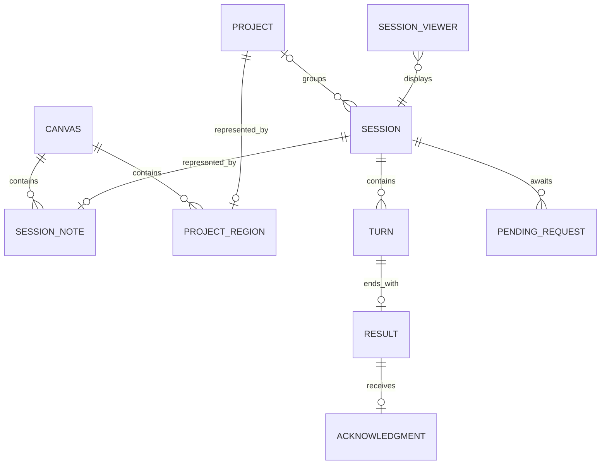
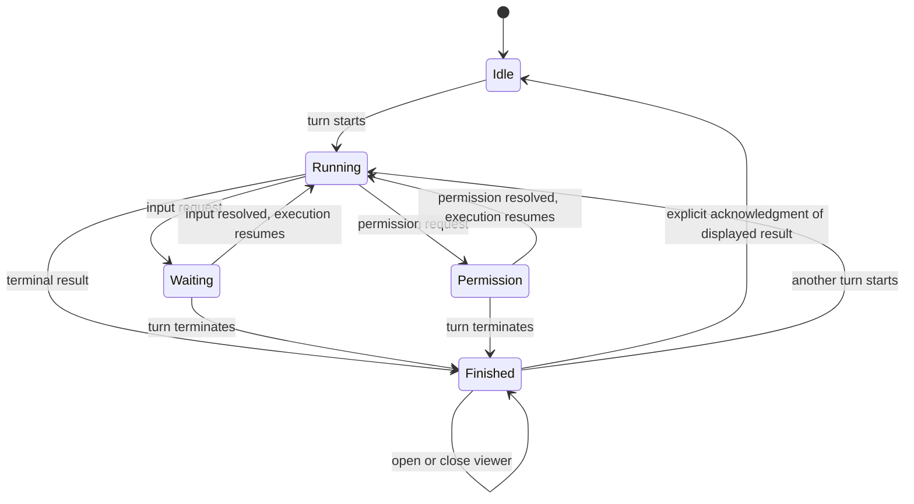

# Session Canvas domain model

## Product intent

Make existing Codex conversations spatially recognizable and make changes that need the user's attention visible. The canvas is an additional way to organize the same sessions, not a second collection of conversations.

Canonical vocabulary lives in [GLOSSARY.md](../GLOSSARY.md). The behavioral contract lives in the [OpenSpec change](../openspec/changes/add-session-canvas/proposal.md).

## Confirmed requirements

- A free-roam canvas displays existing Codex sessions as movable sticky notes showing their name and state.
- Color distinguishes Running, Waiting for you, Permission required, and Finished.
- Finished remains until the user explicitly acknowledges a result while viewing the session. Opening alone never acknowledges it.
- Project regions represent actual project membership. Dropping a note into a region assigns its session; dropping it outside all regions removes membership.
- Right-clicking empty canvas space starts the new-session flow at that location. Clicking a note opens its session.
- Compare a separate local app with an in-app Codex view.
- For the separate-app option, a session/result viewer with Acknowledge and Open in Codex is acceptable.

## Proposed defaults

These resolve unspecified behavior for the first version; they are design choices, not additional user statements.

| Topic | Default | Reason |
| --- | --- | --- |
| Delivery | Native Mac-only SwiftUI/AppKit companion app, selected by the user | Native platform experience with an independent session-source boundary |
| Scope | One user, one local Codex source, one persistent canvas; all non-archived sessions exposed by that source | Existing sessions must appear without being recreated |
| Membership | Zero or one actual Codex project per session | A note has one spatial home |
| Regions | One rectangular region per project; interiors cannot overlap or nest | Every drop has at most one target |
| Drop target | The note's center at pointer release, in canvas coordinates; edges count as outside | Small partial overlaps do not create ambiguous membership |
| Region editing | Move/resize regions; carry member notes on move; resize must retain member centers | Organizing a region must not become accidental mass reassignment |
| Historical results | Latest known terminal result starts unacknowledged unless this app has an acknowledgment for it | Do not silently declare old work reviewed |
| After acknowledgment | Neutral Idle when no work or request is pending | The note remains available for future turns |
| Failures and stops | Finished plus an outcome label: Completed, Failed, or Stopped | A stopped turn still has an outcome to inspect |
| First version viewer | Read-only session history/results with Acknowledge and Open in Codex | Existing Codex remains the place to continue work and answer requests |

## Relationships

A session's identity survives title changes, project moves, repeated turns, and navigation. A note's position belongs to the canvas. Project membership belongs to Codex. A result belongs to a turn. Acknowledgment belongs to the user and the particular result being viewed.

## The two dimensions behind note state

Execution answers “what is Codex doing or waiting for?” Acknowledgment answers “have I explicitly reviewed the latest result?” Combining them into a single stored status would lose information.

Apply the following rules in priority order:

| Priority | Condition | Note state | Suggested color family |
| --- | --- | --- | --- |
| 1 | Current execution observation is unavailable or stale | Unknown, with last-known state secondary | Muted, patterned |
| 2 | Any unresolved permission request | Permission required | Violet |
| 3 | Any unresolved request for the user's input | Waiting for you | Amber |
| 4 | A turn is executing without either request | Running | Blue |
| 5 | No active turn or request; latest terminal result is unacknowledged | Finished, with outcome label | Green |
| 6 | No active turn or request; latest terminal result is acknowledged, or no turn has run | Idle | Neutral |

Color is accompanied by a text label and icon. The exact palette is a visual design choice. A green Finished note does not assert that the turn succeeded; the outcome label is mandatory.

Waiting for a response and requesting permission are pauses, not terminal results. Silence, losing a connection, and unloading a conversation are not evidence that a turn finished.

The diagram shows the ordinary path. Unknown can supersede every displayed state. Resolved requests and out-of-order observations are reconciled against the latest authoritative session revision.

## Domain rules

1. One eligible session has one note. Titles are labels, never identities.
2. A turn has at most one terminal result. Only authoritative terminal evidence creates it.
3. Acknowledging result A cannot acknowledge a newer result B. Record the displayed result's identity, not the session's current status at click-processing time.
4. Opening, focusing, dragging, renaming, or viewing a session does not acknowledge it. Acknowledgment never approves a permission request.
5. A new turn temporarily takes display priority over an older unacknowledged result. The latest terminal result determines Finished when that turn ends.
6. An acknowledgment never hides a currently pending request or active execution.
7. Membership changes only after a successful assignment/removal operation. Moving across a boundary during a drag is a preview.
8. A direct A-to-B drop is one reassignment, with no deliberate intermediate unassignment.
9. Reorganizing a session must not move its checkout, change its working directory, restart its turn, or grant filesystem access.
10. Region geometry is a representation of membership. Region edits do not assign sessions swept by their new bounds.
11. External project moves are reflected by relocating the note to its new region or unassigned space. Unrelated notes retain their positions.
12. A missing page of sessions or a disconnected source is not deletion. Archive/removal requires authoritative evidence.

## Commands and observations

| User intent | Domain command | Required evidence of success |
| --- | --- | --- |
| Place a note within its current area | Move note | Layout persisted |
| Drop across a project boundary | Assign/remove project membership | Codex confirms membership; layout is then reconciled |
| Open a note | Open session viewer | The same session identity is displayed |
| Review a terminal outcome | Acknowledge displayed result | That result's acknowledgment is durably recorded |
| Right-click and submit a prompt | Create session | One existing-source session identity and its resulting execution state |
| Continue work or answer a request | Open in Codex | Native application is asked to navigate to that exact session |

Source observations include a renamed session, new session, changed execution state, pending/resolved request, terminal result, project move, archive, and deletion. Repeated observations must not create repeated notes or results.

## Edge cases used to challenge the model

| Scenario | Expected behavior |
| --- | --- |
| A tool asks for permission while Codex is otherwise active | Permission required takes priority; opening the viewer cannot grant it |
| A final conversational answer asks an ordinary follow-up question | Finished, unless the source exposes an actual pending input request; do not classify prose with heuristics |
| Result B arrives while result A is on screen | Acknowledge acts on A; B remains unacknowledged until displayed and explicitly acknowledged |
| The user acknowledges A after a new turn has started | A is recorded as seen; the note stays Running or shows its current request |
| The app restarts after a result arrives | Restore the result as unacknowledged; show Unknown until refreshed state establishes whether Finished or a higher-priority state applies |
| A turn fails or is manually interrupted | Finished with Failed or Stopped outcome, requiring acknowledgment |
| A note straddles a region boundary | Only its center at drop chooses membership; preview highlights that target |
| A region moves across an unassigned note | Reject the conflicting region edit; the unassigned note is not silently assigned |
| Codex rejects a move for a running session | Restore the last confirmed membership and position; show the reason |
| A project changes externally during a drag | Reject the stale drop and reconcile to current membership; do not overwrite an unseen external change |
| A create request times out after it may have succeeded | Reconcile its operation identity; do not blindly create another session |
| A session is idle in a different process, but this connection cannot observe it | Unknown until the authoritative state is established; no invented completion |

## Boundary of the first version

Pan, zoom, fit-to-content, note dragging, project-region geometry, local layout persistence, existing-session synchronization, session creation, result viewing, acknowledgment, and native navigation are included. Collaboration, arbitrary drawing, links between notes, multiple canvases, archive/delete controls, and replying to Codex or approving its requests inside the canvas viewer are deferred.
