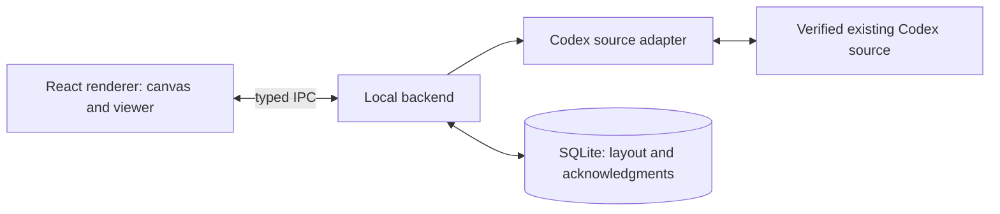

# Technical stack options

Research date: 2026-10-24. This is a comparison and recommendation for the [specified local companion app](../openspec/changes/add-session-canvas/proposal.md), not an accepted stack decision or a benchmark result. Assume macOS first, while preserving the option of Windows/Linux distribution. No particular language expertise or resource budget was supplied.

Subsequent decision: the user selected a native Swift, Mac-only application. The comparison below is retained as research history; the implementation uses SwiftUI/AppKit and SQLite. See [native-application.md](native-application.md).

## Recommendation

For a first release, use **Electron + React + TypeScript + Vite + React Flow + SQLite**. Keep the Codex adapter and database in the local backend, with a narrow typed interface to the renderer.

The main advantage is implementation simplicity across the whole application: the canvas, result viewer, domain projection, and integration code can share TypeScript and runtime validation. The main cost is distributing and running Electron's bundled browser/runtime. This recommendation optimizes delivery effort and predictable rendering, not minimum memory usage.

The strongest alternative is **Tauri 2 + the same React/TypeScript/React Flow frontend + a thin Rust integration/storage backend**. Choose it if a smaller distributed runtime matters enough to justify Rust, IPC bindings, and testing against system webviews. Avoid adding a Node sidecar merely to keep backend code in TypeScript unless its packaging cost is deliberate.

The existing-session integration gate still comes first. A desktop framework can connect processes and render a canvas; it cannot supply missing Codex session/project APIs. See [delivery-options.md](delivery-options.md).

## Whole-application options

These assessments are project-specific engineering judgments. The [desktop shell research](desktop-shell-research.md) records the underlying verified facts and official sources. Footprint comparisons below describe architecture, not measured RAM, CPU, or startup results.

| Stack | Benefits for this application | Drawbacks | When to choose it |
| --- | --- | --- | --- |
| Electron + React/TypeScript + React Flow + SQLite | One primary language; Node integration code can live with the desktop backend; bundled Chromium makes canvas behavior more consistent across systems; useful path to reuse the web UI later | Bundled Chromium/Node and multiple processes add distribution/runtime overhead; Electron updates and renderer/backend separation require maintenance; SQLite binding must match the shipped runtime | Recommended first release when delivery speed and TypeScript reuse matter most |
| Tauri 2 + React/TypeScript + React Flow + Rust + SQLite | Reuses the same UI; Rust owns local connection and storage; uses system webviews instead of shipping a complete Chromium runtime; capability-based bridge | Rust plus TypeScript toolchains; protocol and operation handling cross a language boundary; webview behavior varies by platform; sidecars increase packaging/signing work | A long-lived companion where distributed footprint and native backend control justify the extra integration effort |
| Wails + React/TypeScript + React Flow + Go + SQLite | Comfortable option for a Go-oriented team; Go handles processes, sockets, and persistence; web UI remains reusable | Go plus TypeScript; OS webview testing remains; stable v2 and beta v3 have different desktop-feature maturity, including tray/updater support | Existing Go expertise outweighs the smaller ecosystem and version-specific desktop integration work |
| SwiftUI/AppKit + custom native canvas + SQLite | Direct macOS lifecycle, menu, accessibility, and platform integration; no bundled browser needed for a fully native UI | Mac-only; pan/zoom, selection, note geometry, and accessible custom interactions need native implementation; React Flow cannot be used directly in a fully native canvas; viewer formatting adds work | A deliberately Mac-only product where native behavior is a stronger goal than reuse or quickest delivery |
| Local Node service + browser React UI + React Flow + SQLite | Fast integration/interaction prototype; the UI can be reused in either web-based desktop shell | The browser is only the UI: a separate local service still owns Codex connectivity; service launch/lifetime, localhost access, and installation need a product solution; less cohesive desktop experience | A bounded feasibility prototype or a developer tool with an accepted manual service lifecycle |

Electron's main/renderer process model and Tauri's core/webview model establish the central architectural difference. [Electron process model](https://www.electronjs.org/docs/latest/tutorial/process-model), [Tauri architecture](https://v2.tauri.app/concept/architecture/).

For the browser option, Node has IPC/networking APIs, including Unix-domain sockets and Windows named pipes. That capability belongs to the local service rather than an ordinary web page. [Node networking](https://nodejs.org/api/net.html#ipc-support).

## Canvas library options

The application needs movable, stateful UI objects and project containers. It currently has no drawing tools or node connections. Keeping ordinary HTML/React note content is useful for titles, state badges, accessible controls, and the separate result viewer.

| Canvas approach | Benefits | Drawbacks for this model | Assessment |
| --- | --- | --- | --- |
| React Flow | Built-in navigation and node interaction; custom React notes; parent/child positioning and resize controls; MIT-licensed core | Graph-editor concepts need configuration; drag-to-project confirmation, non-overlapping regions, and domain-specific persistence still belong to us; broad state subscriptions can cause excess renders | Best fit for the first release |
| tldraw SDK | A complete infinite-editor foundation with camera, shapes, selection, and rich interaction; useful if the roadmap grows into a whiteboard | More editor machinery to constrain; source state and acknowledgment must remain outside drawing history; production licensing adds a dependency on a license grant/key | Consider when full whiteboard behavior becomes a product goal |
| Excalidraw | Embeddable React drawing editor with programmatic scene updates; MIT license | Its drawing-scene model is a less direct match for app-like live session notes and confirmed project operations; editing/history behavior needs careful restriction | Good for a sketching-first product; less attractive for this session-control workspace |
| React Konva | Canvas scene graph, dragging, hit detection, and redraw support; detailed control of graphics | Essential text/controls need accessible HTML equivalents; viewport/region rules and UI composition need more custom work | Consider if measured scene-rendering needs justify a graphics-oriented layer |
| Custom DOM/SVG canvas | Complete control and ordinary HTML accessibility; no editor-specific model to adapt | We own gesture handling, transforms, hit testing, drag cancellation, keyboard navigation, selection, culling, and resize behavior | Viable for a narrowly bounded prototype; more interaction code to maintain |

React Flow's core includes drag, pan/zoom, custom React nodes, and resizing/grouping building blocks; Pro includes additional examples and support. A dynamic-grouping example being Pro does not mean the underlying grouping API requires a commercial license. [React Flow overview](https://reactflow.dev/), [custom nodes](https://reactflow.dev/learn/customization/custom-nodes), [examples](https://reactflow.dev/examples).

The current tldraw license allows development by default; production requires a trial, commercial, or discretionary hobby license. The hobby license retains the watermark. Do not equate source availability or successful localhost rendering with permission to distribute a production app. [tldraw license](https://tldraw.dev/community/license).

Excalidraw exposes scene updates and pointer subscriptions and is distributed under MIT. The fit assessment above is an inference about our domain, not a claim that customization is impossible. [Excalidraw API](https://docs.excalidraw.com/docs/@excalidraw/excalidraw/api/props/excalidraw-api), [license](https://github.com/excalidraw/excalidraw/blob/master/LICENSE).

Konva manages canvas objects, hit detection, and redraws, but its shapes are not accessible DOM elements. Its documentation recommends retaining essential content/controls in HTML. [Konva rendering/accessibility trade-offs](https://konvajs.org/docs/posts/canvas-vs-svg.html).

### Applying React Flow to this domain

- Use custom session-note nodes with semantic state colors and labels. Keep graph handles/connections absent from this product's UI.
- Use project container nodes or a region layer for geometry. Keep actual Codex membership as authoritative domain data rather than interpreting every geometric intersection as a confirmed assignment.
- Preview center-based membership during dragging; submit a command on drop; finalize membership after source confirmation.
- If using parent nodes, convert between parent-relative and world coordinates on reparenting. Avoid `extent: 'parent'`, which prevents dragging children out and would conflict with drag-out unassignment. [React Flow subflows](https://reactflow.dev/learn/layouting/sub-flows).
- Keep source facts, attention projection, confirmed layout, and temporary drag state separate. Persist a move at drag completion; do not write every pointer movement or transcript token to the database.
- Memoize note components and subscribe narrowly to state so one changing session does not rerender every note. [React Flow performance](https://reactflow.dev/learn/advanced-use/performance).

## Persistence and state

| Choice | Benefits | Drawbacks | Recommendation |
| --- | --- | --- | --- |
| SQLite in the local backend | Transactions, uniqueness constraints, independent lifecycle from the UI, inspectable/versioned schema; suits acknowledgments and durable pending commands | Requires a binding, schema migrations, and explicit failure handling | Preferred durable store |
| JSON files | Easy to inspect and export; little initial setup | Atomic replacement, consistency between records, recovery, and schema migration become application code | Acceptable for a tiny prototype or export format |
| Browser IndexedDB | Transactional browser API; useful for a browser-only UI prototype | Couples authority to a browser profile/origin; less convenient for a native backend that must reconcile operations while the UI is absent | Keep out of the backend's primary durable operation path |
| Hosted database/service | Supports future shared accounts and collaboration | Adds deployment, authentication, network behavior, and transcript-data handling that the current single-user product does not need | Revisit only when shared/multi-device behavior is specified |

SQLite is explicitly designed for local application storage and desktop application file formats. Atomic transactions make acknowledgment and pending-operation records easier to keep consistent. They do not make an external Codex mutation and a local commit one distributed transaction; operation reconciliation is still required. [SQLite application uses](https://www.sqlite.org/whentouse.html), [atomic commit](https://www.sqlite.org/atomiccommit.html).

For the initial single-backend writer, use SQLite's normal transactional behavior. Enable WAL only if observed reader/writer concurrency warrants it; WAL adds checkpointing and sidecar-file considerations and does not remove the single-writer constraint. [SQLite WAL](https://www.sqlite.org/wal.html).

Persist canvas positions, region bounds, viewport, per-result acknowledgments, source identity/revision evidence, and pending operations. Fetch transcript pages on demand rather than keeping another complete conversation database. Use a small renderer store with narrow subscriptions and pure attention-state calculations; a CRDT or full workflow engine is unnecessary for the current single-user requirements.

## Proposed Electron architecture

Build the renderer with Vite, which provides development tooling and a production static-assets build. The packaged app loads those built assets; a production frontend server is unnecessary for this design. [Vite guide](https://vite.dev/guide/).

Suggested package boundaries are a UI-independent TypeScript domain model, a replaceable Codex adapter, a local persistence service, and the renderer. Use versioned, validated messages at the process boundary. The renderer gets specific commands and subscriptions, not a general shell/process API. Keep heavier parsing/storage work off the renderer and measure whether it needs a backend worker before adding one.

The same frontend fits Tauri/Wails. Their native backend replaces the Node service implementation; preserving a typed boundary reduces UI rework, but it does not make TypeScript backend code automatically reusable in Rust or Go.

## What to measure before committing

1. **Integration correctness:** Observe and organize the same existing desktop sessions, including a request, terminal result, and external project move. This is the highest-risk unknown for every stack.
2. **Interaction fit:** Build a small React Flow proof for move-region, drop-in/drop-out, rejected membership mutation, and result A/B acknowledgment races.
3. **Representative scale:** Test 100, 500, and 2,000 total notes with different visible counts, status bursts, and a long paginated transcript. These are test cases, not promised capacity limits.
4. **Actual footprint:** Compare packaged size, idle and active memory/CPU, startup, and drag frame times on the target Mac, using equivalent release builds and the same data. Count helper processes and any shipped sidecars.
5. **Lifecycle/distribution:** Check reconnect after sleep, reopening the window, clean quitting, and a packaged signed app's ability to reach the existing Codex source.

If Electron's measured footprint fits, its simpler language/runtime boundary is valuable. If footprint fails the desired budget, trial Tauri using the same UI and a small native adapter. Choose Wails for a Go-based ownership advantage, or native Swift for an explicitly Mac-only product direction.
