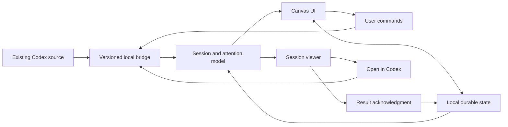

# Design

## Context

See [proposal.md](proposal.md) for product scope, [the domain model](../../../docs/domain-model.md) for state and membership rules, and [delivery-options.md](../../../docs/delivery-options.md) for the investigated integration surfaces and their limits. The user selected native Swift on macOS; the implementation now uses SwiftUI/AppKit and SQLite. [The native guide](../../../docs/native-application.md) describes its concrete modules.

The user confirmed explicit acknowledgment and accepted a session/result viewer with Acknowledge and Open in Codex. Saved-session discovery and a native read-only history reader are verified. The shared desktop control socket was unavailable, and no independent application's access to the agent tools in this chat is assumed. See [the compatibility report](../../../docs/integration-compatibility.md).

## Goals / Non-Goals

**Goals:**

- Separate the reusable canvas/domain behavior from its delivery shell and version-specific Codex integration.
- Preserve source identity and execution context while organizing sessions spatially.
- Make partial synchronization and unconfirmed mutations visible without losing layout or acknowledgment.

**Non-Goals:**

- Implementing a second agent runtime or taking execution ownership from desktop.
- Patching desktop bundles, depending on private database writes, or treating filesystem observation as proof of live execution state.
- Introducing a browser renderer, cross-platform shell, or hosted persistence into the selected Mac-only application.

## Decisions

### 1. Native Mac-only companion with an independent domain core

Use SwiftUI for the window, sidebar, forms, and read-only session viewer; AppKit owns canvas drawing, hit testing, gestures, keyboard handling, and accessibility elements. The Swift CanvasCore module owns attention projection, geometry, source decoding, and SQLite persistence. SessionSource keeps the protocol boundary independent of the UI. A browser plugin would need a separate UI implementation; Swift views are not treated as reusable web components.

The earlier Electron/Tauri recommendation is retained as research history. The user selected native Swift for a Mac-only experience. This gives direct platform integration at the cost of custom interaction code and cross-platform UI reuse. This companion does not modify the Codex/ChatGPT desktop application's own code or bundles.

### 2. Prove each integration capability before enabling it

The full integration gate requires the six demonstrations in delivery-options.md against existing desktop sessions. The native implementation enables verified saved-session discovery/history and keeps unavailable mutations disabled. Record target CLI/app versions, endpoint, capability evidence, commands, and failures without secrets or transcript dumps.

The existing desktop socket was unavailable. The installed CLI supplies metadata discovery; incompatible newer histories use an identity-checked local reader on the exact inventory-provided rollout paths. A supported shared source/control transport remains preferred for live execution and mutations. The full integration track remains incomplete while essential capabilities are unavailable; the native UI can be evaluated separately in labeled demo mode. Projects are never redefined as local labels.

Conceptual operations required from the integration boundary:

| Operation | Contract |
| --- | --- |
| Discover sessions/projects | Stable identities, complete pagination, archive state, project membership, title, and source revision |
| Observe current session | Execution evidence, pending request identities, active turn identity, freshness, and authoritative terminal results |
| Read session history | Paginated read-only content with stable turn/result identities |
| Change membership | Assign project or null against expected membership revision; return confirmed state or explicit rejection |
| Create session/submit initial instruction | Persist an operation identity; recover ambiguous outcomes; identify an already-created session if turn submission fails |
| Open native session | Request navigation to the same source session ID and report dispatch failure |

These names describe product needs, not existing Codex RPC method names. Unsupported operations must be surfaced explicitly. Session discovery must include the desktop-relevant source kinds, rather than relying on filters that expose only another client's threads.

### 3. Separate source facts, layout, and acknowledgment

| Record | Identity and owner | Important contents |
| --- | --- | --- |
| Session projection | Source ID + session ID; Codex authoritative | Title, project ID, active turn, pending requests, execution evidence, source revision/freshness |
| Terminal result | Source ID + session ID + turn ID + terminal revision; Codex authoritative | Outcome, order within the session, content reference |
| Note placement | Canvas ID + source/session identity; canvas-owned | Canvas-coordinate position and stacking order |
| Project region | Canvas ID + source/project identity; canvas-owned geometry | Bounds; name comes from source |
| Viewport | Canvas ID; canvas-owned | Pan offset and zoom |
| Acknowledgment | User + source/session + result identity; canvas-owned | Explicitly acknowledged result and local recording time |
| Pending operation | Client operation ID; canvas-owned | Target/source identity, expected revision, intended mutation, last confirmed state, resolution state |

Normalize source IDs at the boundary. Titles and timestamps are never deduplication keys. Do not derive project identity from a working-directory path. Do not store a single mutable `finished` boolean as a substitute for result identity.

Persist layout, acknowledgments, pending operations, and the minimum source evidence needed for recovery. Fetch transcript pages for the viewer on demand; do not create a second durable full-history store by default. Restored execution observations are stale until refreshed, so notes initially show Unknown with their last-known state.

### 4. Derive attention from evidence

Use the ordered state table in domain-model.md as a pure projection. The adapter normalizes actual source requests into pending input or permission requests. It must not infer requests from assistant prose, inactivity, or the absence of a loaded thread in a new process.

Track multiple pending request identities. Clear only the request the source resolves, or all requests when that turn authoritatively terminates. Keep terminal evidence by turn identity and source order; a late turn-A event cannot replace turn B's current execution.

On connection loss, invalid observation, or failed freshness verification, mark the relevant state unavailable. Establish freshness from connection/heartbeat/reconciliation evidence, not the time since the assistant last emitted text. After reconnecting, obtain authoritative current state before accepting incremental observations. When ordering is uncertain, re-read instead of comparing wall-clock timestamps.

The viewer retains the displayed result identity. If another result arrives, advertise View latest without retargeting an existing Acknowledge action. Commit acknowledgment durably before clearing its visual attention. A repeated terminal observation cannot invalidate an existing acknowledgment of the same result.

### 5. Treat spatial changes as explicit commands

Store positions and bounds in world/canvas coordinates, independently from screen coordinates. Distinguish pointer clicks from drags using an interaction threshold; suppress click after a drag or cancellation. Hit-test a note's center only when the drop commits, with the same calculation used for preview. Region borders count as unassigned space.

Within the current membership area, a move is a local layout operation. Across membership boundaries, persist a pending command and submit a conditional membership change. Show a pending placement, serialize membership changes for that session, and commit the desired layout after confirmed success. On rejection, restore confirmed placement; if newer external membership exists, reconcile to that newer state instead.

If a response is lost, recover the pending operation and read source membership before deciding its outcome. Do not replay an uncertain mutation. A bridge that cannot protect against unseen external membership changes does not satisfy the stale-drop scenario.

Region interiors do not overlap. Move member notes together with their region. Reject edits that leave member centers outside, overlap another region, or enclose nonmember centers. Auto-placement for discovery/external moves chooses vacant space in the correct region, expanding or relocating geometry without displacing unrelated notes or enclosing unrelated centers.

### 6. Creation and navigation retain the same conversation

Capture project ID and canvas location when the context menu opens. Before submission, verify that the region/project still exists and resolve the source execution context; do not choose an unrelated working directory. Persist a client operation identity before submitting. Use source idempotency when available, otherwise require a reliable correlation/recovery mechanism before permitting a retry.

If session creation succeeds but initial-turn submission fails, keep the returned session identity and retry only submission after reconciliation. Deduplicate the later inventory event by the same session identity. The viewer is read-only for continuing work: Open in Codex uses the integration-gate-proven navigation mechanism. No speculative deep-link scheme is hard-coded into this specification.

### 7. Local state is independent of the rendered component

Keep durable state in the local service/application rather than in a mounted plugin iframe or ephemeral view. This allows the canvas to survive viewer navigation and supports a later plugin shell. Keep bridge access local and narrowly scoped, and preserve existing Codex authentication, execution, and approval policies. Reading or acknowledging must never submit an instruction or approval.

## Risks / Trade-offs

- [Desktop execution is owned by another process or host] → Prove shared-source observation; a new isolated server's state is insufficient.
- [Actual project APIs or native navigation are unavailable] → Fail the integration gate and reassess delivery; do not silently reduce the behavior.
- [A plugin surface differs between ChatGPT and the target Codex view] → Compatibility-test the exact installation before pursuing the optional shell.
- [Old inactive sessions create many Finished notes on first import] → Preserve the explicit-review contract; consider a separately specified onboarding review policy later.
- [Source revision or request semantics vary by version] → Version the adapter and record fixtures for verified supported versions; display Unknown for unsupported evidence.
- [External mutation succeeds while local persistence fails] → Recover from the durable pending operation and authoritative membership; show unsaved layout instead of issuing a compensating source mutation automatically.
- [Viewer history rendering grows into a second chat client] → Keep it read-only and delegate continuation, input responses, and permission approval to native Codex.

## Migration Plan

There is no existing application data to migrate. Start with a versioned local-state format and stable source-qualified IDs. First load discovers actual projects and non-archived sessions, creates regions and placements, and imports the latest terminal result without implicit acknowledgment.

Validate domain behavior with source fixtures after the integration contract is proven, then run end-to-end checks against the same desktop source. A later plugin shell must consume the same domain core and persisted data rather than create a second canvas. Rollback closes/disables the companion; it must not delete source sessions or rewrite project memberships. Membership changes deliberately made by the user remain real source changes.
