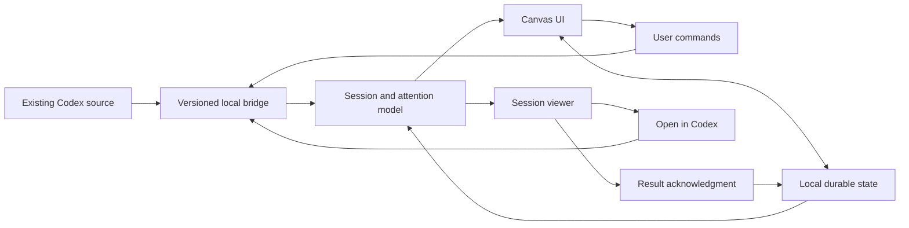

# Design

## Context

See [proposal.md](proposal.md) for product scope, [the domain model](../../../docs/domain-model.md) for state and membership rules, and [delivery-options.md](../../../docs/delivery-options.md) for the investigated integration surfaces and their limits. The user selected native Swift on macOS; the implementation now uses SwiftUI/AppKit and SQLite. [The native guide](../../../docs/native-application.md) describes its concrete modules.

The user confirmed explicit acknowledgment and accepted a session/result viewer with Acknowledge and Open in Codex. Subsequent corrections add canvas clipping, semantic zoom without project reflow, visibility controls, native toolbar/sidebar behavior, live desktop state, newest-first history with fixed controls, and creation from project areas. These are mapped to requirements and verification in [verification.md](verification.md).

The default app now combines CLI inventory/history, validated saved project metadata, and read-only observations from the desktop's existing coordination socket. Empty-session creation with real project identity is verified against the newer bundled server in an isolated home. The default shared control proxy remains unavailable on the tested installation; it is distinct from the working desktop observation socket. No independent application's access to agent tools in this chat is assumed. See [the compatibility report](../../../docs/integration-compatibility.md).

## Goals / Non-Goals

**Goals:**

- Separate the reusable canvas/domain behavior from its delivery shell and version-specific Codex integration.
- Preserve source identity and execution context while organizing sessions spatially.
- Make partial synchronization and unconfirmed mutations visible without losing layout or acknowledgment.

**Non-Goals:**

- Implementing a second agent runtime or taking execution ownership from desktop.
- Patching desktop bundles, depending on private database writes, or treating filesystem observation as proof of live execution state.
- Introducing a browser renderer, cross-platform shell, or hosted persistence into the selected Mac-only application.

## Decisions

### 1. Native Mac-only companion with an independent domain core

Use SwiftUI for the window, sidebar, forms, and read-only session viewer; AppKit owns canvas drawing, hit testing, gestures, keyboard handling, and accessibility elements. The Swift CanvasCore module owns attention projection, geometry, source decoding, and SQLite persistence. SessionSource keeps the protocol boundary independent of the UI. A browser plugin would need a separate UI implementation; Swift views are not treated as reusable web components.

The earlier Electron/Tauri recommendation is retained as research history. The user selected native Swift for a Mac-only experience. This gives direct platform integration at the cost of custom interaction code and cross-platform UI reuse. This companion does not modify the Codex/ChatGPT desktop application's own code or bundles.

### 2. Prove each integration capability before enabling it

The full integration gate requires the six demonstrations in delivery-options.md against existing desktop sessions. Enable capabilities individually from observed evidence: inventory/history, actual project discovery, live desktop observation, and empty-session creation have bounded evidence. Existing-session membership writes are disabled for every real connection because backend persistence did not change desktop membership; shared-mode creation also stays disabled. Record target CLI/app versions, endpoint, capability evidence, commands, and failures without secrets or transcript dumps. The partial gate must remain visible in tasks and verification rather than presenting every requirement as implemented.

Use the desktop-bundled CLI by default. A separate stdio server can list saved sessions but reports desktop-active threads as `notLoaded`; that is not execution evidence. The read-only `DesktopRuntime` follows the existing local coordination socket's version-11 snapshots and patches. Validate socket/peer ownership, owner/revision identity, and frame size; request a fresh snapshot on a revision gap and reconnect automatically. Missing or unsupported feeds clear live observations to Unknown. Observation never claims ownership, resumes a thread, submits a turn, or answers a request. A history refresh cannot erase a newer live observation.

Filter Guardian/sub-agent sessions by structured source/parent metadata, including cached notes. Read projects and explicit assignments from the connected home's exact `.codex-global-state.json`; validate its shape and bound the read. Preserve explicit desktop assignments/projectless entries over API fallback regardless of move capability: null does not prove desktop unassignment. Legacy Canvas confirmations never override desktop membership. Remote/unknown exclusions remain enforced. Resolve only the connected home's legacy-to-server project mapping. Never infer project identity from `cwd`, mutate source metadata files, or replace actual projects with local labels. Invalid metadata retains the last confirmed workspace and reports an error.

For history, negotiate paginated APIs, then legacy reading, then an identity-checked local reader on exact inventory-provided rollout paths. Bound the fallback and its records; do not render arbitrary tool payloads or hidden reasoning. Projects and desktop IPC remain private compatibility formats. Keep their limits separate from public server API support and from the isolated demo's simulated mutations.

Conceptual operations required from the integration boundary:

| Operation | Contract |
| --- | --- |
| Discover sessions/projects | Stable identities, complete pagination, archive state, project membership, title, and source revision |
| Observe current session | Execution evidence, pending request identities, active turn identity, freshness, and authoritative terminal results |
| Read session history | Paginated read-only content with stable turn/result identities |
| Change membership | Assign project or null against expected membership revision; return confirmed state or explicit rejection |
| Create empty session | Confirm server project identity/roots, create a durable thread, retain its identity, and hand off the initial instruction to Codex; never automatically retry an uncertain start |
| Open native session | Request navigation to the same source session ID and report dispatch failure |

These names describe product needs, not existing Codex RPC method names. Unsupported operations must be surfaced explicitly. Session discovery must include the desktop-relevant source kinds, rather than relying on filters that expose only another client's threads.

### 3. Separate source facts, layout, and acknowledgment

| Record | Identity and owner | Important contents |
| --- | --- | --- |
| Session projection | Source ID + session ID; Codex authoritative | Title, project ID, active turn, pending requests, execution evidence, source revision/freshness |
| Terminal result | Source ID + session ID + turn ID + terminal revision; Codex authoritative | Outcome, order within the session, content reference |
| Note placement | Canvas ID + source/session identity; canvas-owned | Canvas-coordinate position and stacking order |
| Project region | Canvas ID + source/project identity; canvas-owned geometry | Bounds; name comes from source |
| Viewport | Canvas ID; canvas-owned | Pan offset and zoom |
| Visibility | Source ID; canvas-owned | Independently hidden attention states and project IDs; search is transient |
| Acknowledgment | User + source/session + result identity; canvas-owned | Explicitly acknowledged result and local recording time |
| Pending operation (remaining design target) | Client operation ID; canvas-owned | Durable correlation/recovery for uncertain mutations; not yet implemented across application restarts |

Normalize source IDs at the boundary. Titles and timestamps are never deduplication keys. Do not derive project identity from a working-directory path. Do not store a single mutable `finished` boolean as a substitute for result identity.

The current SQLite schema stores workspace geometry/viewport, the narrow session/result cache, explicit acknowledgments, and source-qualified visibility (schema version 2). Search and sidebar presentation are view state. Fetch transcript pages on demand rather than creating a second durable full-history store. Restored execution observations are stale until refreshed and initially show Unknown. Durable pending-operation records and separate last-known execution presentation remain acceptance work, tracked in tasks and verification; the current cache is not evidence that those requirements are complete.

### 4. Derive attention from evidence

Use the ordered state table in domain-model.md as a pure projection. The adapter normalizes actual source requests into pending input or permission requests. It must not infer requests from assistant prose, inactivity, or the absence of a loaded thread in a new process.

Track multiple pending request identities. Clear only the request the source resolves, or all requests when that turn authoritatively terminates. Keep terminal evidence by turn identity and source order; a late turn-A event cannot replace turn B's current execution.

On connection loss, invalid observation, or failed freshness verification, mark the relevant state unavailable. Establish freshness from connection/heartbeat/reconciliation evidence, not the time since the assistant last emitted text. After reconnecting, obtain authoritative current state before accepting incremental observations. When ordering is uncertain, re-read instead of comparing wall-clock timestamps.

The viewer retains the displayed result identity. If another result arrives, advertise View latest without retargeting an existing Acknowledge action. Enable the action only while the selected session's current derived state is Finished and its target result is loaded and unacknowledged. UI availability and the command share one eligibility predicate; the command rechecks the current session before writing. A new turn, unresolved request, or lost live evidence disables acknowledgment even when an older result remains loaded. Commit an eligible acknowledgment durably before clearing visual attention. Repeated terminal observations do not invalidate prior acknowledgments.

The top toolbar also exposes Acknowledge all as an explicit exception to the viewer-loading requirement. At invocation, capture the latest known result of every current-source Finished session across all filters. A single SQLite transaction inserts the exact source/session/result identities; a failed batch rolls back entirely and leaves the model unchanged. Reuse one prepared statement and publish one acknowledgment dictionary update after commit, then reevaluate visibility once. Do not load histories or send source commands. Disable while disconnected/refreshing, without storage, or with no targets. Main-actor synchronous capture/commit prevents a newly arriving result from joining an older click's batch.

For a known acknowledged result, the same viewer button changes to Mark as unread. Its target is the displayed result, falling back to the known acknowledged latest result when history is unavailable. It can remove that exact review record in any note state after loading ends; it does not acknowledge an unshown unread result. Commit the deletion before changing the model. Keep source execution, requests, archive/project facts, activity, geometry, and other review records unchanged. Removing the latest acknowledgment returns verified inactive work to Finished; higher-priority states retain their normal appearance. No schema migration is needed.

### 5. Treat spatial changes as explicit commands

Store positions and bounds in world/canvas coordinates, independently from screen coordinates. Distinguish pointer clicks from drags using an interaction threshold; suppress click after a drag or cancellation. Hit-test a note's center only when the drop commits, with the same calculation used for preview. Region borders count as unassigned space.

The real adapter does not enable membership writes from project APIs or a server version alone. The authorized live test on 0.164.0-alpha.11.1 reproduced a successful SQLite-backed `thread/metadata/update.projectId` and matching backend readback while the desktop remained projectless. Codex's native project action updated desktop membership without changing that backend field. The candidate API therefore does not implement the required desktop transition. Keep `canAssignProject` false and reject direct assignment calls before any RPC write. Menu actions are disabled; boundary-crossing drops preserve confirmed geometry and explain that organization must currently be done in Codex. An API-only desktop integration remains unfinished; do not substitute UI automation or direct metadata-file writes.

Initialization userAgent prefixes and isolated schema/backend tests establish protocol compatibility only. They cannot establish that the running desktop applies project changes. The old native-originator version gate is removed from move enablement. Future support must be demonstrated through a permitted desktop API, including actual assignment/reassignment/removal and independent desktop readback, before enabling any real-source write.

ProjectMembershipConfirmation remains decodable only for compatibility with old SQLite snapshots. Do not restore it as source evidence, seed backend membership from it, or let catalog mapping honor it. Fresh snapshots and history observations clear the field. Explicit desktop assignments/projectless markers remain authoritative over backend fallback. Include desktop membership in source revisions so an external project change invalidates a stale drag even when the backend timestamp is unchanged. This repairs old Canvas-only placements on refresh while preserving result/acknowledgment identities.

For capable sources such as the isolated demo, the model retains confirmed coordinates while pending, serializes per-session changes, and commits only confirmed membership/revision and coordinates. For the real connection, reject before submitting a mutation. Keep execution, requests, results, acknowledgments, and viewport independent of project organization.

Within the current membership area, a move remains a local layout operation. The full design target additionally persists a pending command and submits a conditional membership change. Current guards are in memory; the observed API has no expected-revision/CAS parameter. Preflight rejects changes already present before the read, and postflight confirms the final value, but an external write between them can race. Keep that atomic-conflict and durable pending-recovery acceptance open rather than claiming complete stale-drop protection.

If a response is lost, recover the pending operation and read source membership before deciding its outcome. Do not replay an uncertain mutation. A bridge that cannot protect against unseen external membership changes does not satisfy the stale-drop scenario.

Region interiors do not overlap. Move member notes together with their region. Reject edits that leave member centers outside, overlap another region, or enclose nonmember centers. Auto-placement for discovery/external moves chooses vacant space in the correct region, expanding or relocating geometry without displacing unrelated notes or enclosing unrelated centers.

### 6. Creation and navigation retain the same conversation

Capture project ID and world-coordinate location from canvas background or a project area, including the distant overview. Preselect the project in the creation sheet. The desktop form accepts an optional name and creates an empty session; entering and executing the instruction belongs to Codex. The demo alone accepts a simulated initial prompt. For a projectless session, an explicit working folder must exist; leaving it blank creates a unique workspace under `Application Support/Session Canvas/Workspaces`. Blank names become New session. Explain these defaults in the form. After verified creation and ownership release, select/reveal the new note and viewer and automatically request native opening of that exact identity. Retain Open in Codex for retries. A creation warning prevents automatic navigation. The injectable native URL opener lets tests verify dispatch without opening synthetic fixture identities in the user's desktop.

A source-level create result is not sufficient UI acceptance: the new empty note is normally Unknown, and saved Unknown/search/project filters can hide it before the viewer opens. Keep one transient `revealedCreationID` outside persisted visibility. Include that exact session in rendering, project visibility, and counts and open its viewer. If placement at the clicked world coordinate satisfies membership/collision rules, retain that position. Otherwise search positions aligned with the requested coordinate, note edges, and project-center boundaries and choose the closest valid position by squared world distance; include filtered current geometry from the destination layer and exclude the newly created note's provisional placement. Do not retain the origin-based discovery-grid fallback after a collision. Use the refreshed session's confirmed membership. For same-layer creation in the context's project, preserve pan/zoom even after collision adjustment. A changed chosen/confirmed project, changed classified layer, or explicit focus action centers it at detail zoom. Select only the confirmed session's layer before revealing it. Explain any filter exception and provide Apply filters. Preserve saved filters and search. Refresh keeps the exception; explicit search/visibility changes, Apply filters, another creation, and reconnect clear it. Closing the viewer alone does not change the reveal. Creation errors belong inside the active sheet, with inputs retained, rather than in a covered parent's alert.

SwiftUI can resize the canvas after an explicit focus request or focus for a changed project when the viewer appears. Only when that focus was requested and the creation note is still at the previous viewport center, adjust the origin by half the size delta to preserve its center in the remaining canvas. A note placed at or near the click must not trigger this adjustment merely because it happens to be centered. Once the user pans away, resizing must not recenter it. Native-event regressions cover both click preservation and explicit-focus resize behavior.

The tested bundled server omits an empty saved session from `thread/list`, even though exact-ID read/resume and native loading work. Show a successful creation notice and direct Open in Codex rather than requiring discovery through the desktop's list. Do not inject placeholder user messages or start a turn merely to populate that list. A native keyboard-event test activates the actual SwiftUI creation button through its default Return action; model/real-server tests separately verify visibility, ownership release, and continuation identity.

Negotiate the newer server's project APIs before enabling desktop creation. Re-read the connected home's project identity mapping and use `project/read` to confirm the backend project and roots before `thread/start(projectId:, ephemeral: false)`. Do not infer membership from the folder or override model/approval settings. Use a dedicated short-lived child process initialized against the same Codex home, separate from the inventory/history connection. Always set a name, including the generated default: the bundled server does not persist a resumable empty rollout from `thread/start` alone. Stop and await this creator, then initialize an independent verifier and call `thread/resume(excludeTurns: true)` for the exact identity; verify saved identity/membership and stop/await the verifier before returning. No turn is submitted. Empty durable threads can be omitted from inventory until their first message; retain confirmed source identity and membership in the canvas cache without inventing execution evidence.

The isolated reproduction established that `thread/read` can return metadata while no rollout exists, and `thread/unsubscribe` leaves the creator's thread lock held. Process exit releases the lock. Merely unsubscribing or reconnecting a reader is therefore insufficient. Await only Canvas-owned children asynchronously, with a bounded graceful termination period before forcing that child to exit; never terminate the desktop or an unrelated server.

Never repeat an uncertain `thread/start`, which has no idempotency key. The dedicated stdio connection can recover a lost reply from its `thread/started` notification. Without confirmation, disable further creation and require checking Codex before reconnecting. After a confirmed start, naming, metadata-check, or navigation failure retains the existing note and reports the failure rather than creating a replacement. Cross-restart recovery of an unconfirmed start is still open work; no durable creation-operation journal currently exists.

Open in Codex dispatches the exact session ID through the configured `codex://threads/{id}` route after checking the scheme and registered handler. Dispatch failure is visible and retryable. Registration and dispatch are verified separately from full native host route acceptance. Neither creation nor viewing submits a turn, resumes work, grants permission, or acknowledges a result.

For real session notes, Open in Codex is the first context-menu item. Omit the duplicate Open session item: primary click and the keyboard open action already open the local viewer. Demo notes keep native navigation unavailable because their identities are synthetic.

### 7. Local state is independent of the rendered component

Keep durable state in the local service/application rather than in a mounted plugin iframe or ephemeral view. This allows the canvas to survive viewer navigation and supports a later plugin shell. Keep bridge access local and narrowly scoped, and preserve existing Codex authentication, execution, and approval policies. Reading or acknowledging must never submit an instruction or approval.

### 8. Render a stable, filterable canvas at every zoom

Clip notes, project areas, labels, dots, and shadows to the AppKit canvas bounds. The native top toolbar owns New Session, Rearrange, Fit to Content, Full Screen, and labeled Acknowledge all; no workspace heading, tagline, or gray header panel sits above the canvas. A native `NavigationSplitView` sidebar toggles through its toolbar control or Shift + Command + S without resetting canvas state.

Use one derived visible set: search, independently enabled attention states, and hidden project IDs all apply. Omit projects with no visible sessions from the sidebar, canvas, overview, accessibility targets, and fit bounds. Hidden projects have individual/all restore controls. Changes of session state or acknowledgment reevaluate filters; close the viewer if its session becomes hidden. Persist attention/project visibility per source while retaining all underlying layout and membership, including hidden members.

At distant zooms, render a project overview instead of its member notes. Project areas and hit targets use exactly the viewport projection of saved world bounds. Never enlarge, rearrange, or clamp areas to keep labels on screen. Lay out a readable, tail-truncated project name only when a meaningful prefix plus ellipsis and a complete line fit; otherwise draw only the area. Counts and attention dots require additional room. At closer zooms, note text also uses complete lines rather than vertically clipped glyphs.

A project area stays interactive even without text. A click zooms into its sessions at a readable scale; dragging any part moves the region and all members, including hidden notes, by the same world displacement. Preview uses the same transform as commit, with no viewport change. Escape cancels, Space + drag pans, and collision/membership-preservation rules remain active. The project context menu provides creation, zoom, and hiding at every zoom.

### 9. Keep viewer history and controls predictable

Keep source history chronological internally and render it in reverse, newest at the top. Opening or reloading positions the transcript at its newest entry. Loading older pages inserts older content below the newer entries without scrolling to the bottom. A fixed panel above the scrolling transcript holds Acknowledge result, Open in Codex, Reload history, and pagination; use a wrapping layout for narrow viewers.

The header's acknowledgment targets the newest loaded terminal result. A newer unloaded result offers View latest result without retargeting the existing action. Keep acknowledgment disabled outside Finished, while history loads, or for an unloaded unread result. An acknowledged target instead offers enabled Mark as unread after loading, regardless of note state; a known acknowledged latest result can be used when no history loaded. Reading, reloading, scrolling, opening natively, and closing remain independent of acknowledgment.

### 10. Stable local verification permission

Use `scripts/verify-local.py` as the single build/test/native-preview entry point. Codex invokes its absolute path directly, and a general command-prefix allow rule in the user's `default.rules` authorizes that script outside the sandbox after the user's setup request. Argument changes do not change the prefix. Other scripts receive no permission from this rule; the workspace sandbox and unrelated rules remain in force. Moving the checkout requires a new absolute-path rule. Rule files load at Codex startup; existing chats and already-visible approval dialogs can retain the previous policy. An explicit `execpolicy check --rules` result verifies the supplied files, not runtime policy reload or absence of prompts.

The launcher executes fixed subprocess argument lists, directs SwiftPM/module caches under `.build`, and exposes explicit installed-source opt-in. Preview rebuilds/signs the bundle and defaults to a fresh demo database and PNG under `.build/verification`. Resolve explicit SQLite/PNG outputs against verification, temporary, and Codex visualization roots before starting any subprocess. Preserve the real application database. A bounded capture must produce a fresh PNG and a successful process exit; stale files are not verification evidence. This development permission is independent of permission requests displayed by the product's session viewer.

### 11. Reuse hosted verification before drafting releases

Use GitHub Actions for this GitHub repository. The CI workflow handles pull requests and main-branch pushes and is reusable by the release workflow. Test on `macos-15` (Apple Silicon) and `macos-15-intel`, selecting Xcode 16.4 explicitly. Run normal Swift Testing suites, Python tooling checks, release compilation, and bundle signature verification. Validate all OpenSpec artifacts separately with the pinned CLI version. Hosted fixtures/native rendering do not close opt-in installed-Codex acceptance gates. Repository reads suffice for all checks; do not persist checkout credentials or supply desktop/session/signing secrets.

Keep project-focus geometry in the domain's `Double` after converting AppKit dimensions explicitly. The first hosted Swift 6.1 build rejected mixed `CGFloat`/`Double` division accepted by local Swift 6.4; the explicit conversion retains the existing focus formula rather than raising CI's selected compiler version. Hosted compilation is the regression check for that compiler compatibility; existing semantic-zoom/native-event tests verify positioning.

Activate the native submit-button regression through the hosted form's Return/default-button route. Sequential synthetic mouse delivery blocked in macOS 15 tracking; injecting its release could prematurely drain the Swift async-main runner. Keyboard activation retains the real SwiftUI action and one-create/navigation assertions without a nested tracking loop; canvas pointer regressions remain. Render OCR input at a fixed 2× density independent of the screen, use English and the best Vision candidate, and retain exact complete-text assertions with language correction disabled. Trying five candidates alone did not resolve macOS 15's `i`/`l` confusion in the low-density capture. Bound the CI test step to five minutes and require both Swift Testing's successful-run summary and project-creation suite completion as well as a zero exit code. Retain failed-test logs and fixture PNGs for seven days. These changes affect verification, not the application's creation/layout contract.

Release dispatch accepts `vMAJOR.MINOR.PATCH` and resolves an existing tag to its commit or uses the dispatch revision for a new tag. A version-tag push takes the same path. Pass the exact resolved commit into both architecture jobs and specification validation. Only after all succeed does the final job receive repository write permission and create a draft release, creating a missing tag at that verified commit. Recheck an existing tag's resolved commit before uploading and fail if it moved. Reruns may replace draft assets but must reject published releases. Publication remains a maintainer action, allowing review before GitHub makes assets immutable.

Extend the existing app builder with validated version/build metadata while preserving local defaults. Package separate native ZIPs with `ditto`, preserving the app structure and executable permissions; verify architecture with `lipo`, verify the ad-hoc signature, and provide SHA-256 files checked again before upload. Use the tag version in Info.plist and filenames and the workflow run number as the build number. Separate archives provide native test coverage without adding universal-binary assembly. Developer ID signing and notarization remain outside this change; document Gatekeeper limitations. See the [CI/CD guide](../../../docs/ci-cd.md).

Routine Git/GitHub delivery follows the user's standing authorization: working branch, verified task-only commit, ordinary branch push, and PR creation/update without another conversation-level confirmation. General command prefixes and instructions are installed in the user's default.rules and AGENTS.md after renewed authorization; SSH and GitHub CLI repository access were verified. The enabled GitHub plugin separately inherits Allow low-risk actions. [The delivery workflow](../../../docs/git-workflow.md) records setup status, protected operations, authentication prerequisites, and rule-loading limits. This agent configuration changes no application behavior or product requirements.

### 12. Package the selected application icon

Use the selected blue session-cards PNG as the application identity. Export its unchanged artwork at the standard 16, 32, 128, 256, and 512-point iconset sizes with 1×/2× representations using `sips`, then assemble the checked-in `assets/branding/SessionCanvas.icns` with `iconutil`. The shared app builder copies that resource into `Contents/Resources` and sets `CFBundleIconFile` before codesigning. A missing source resource fails before signing. Local verification and architecture-specific releases share this packaging path. Retain original and light alternatives as review assets without choosing them implicitly. Canvas, source, and acknowledgment behavior are unaffected.

### Explicit visible layout

All packing and carried/fixed geometry in this section is scoped to current occupants of the selected layer; cross-layer geometry and departed records are excluded.

CanvasRearranger is a pure CanvasCore planner over a workspace, current visible session IDs, and acknowledgments. Derive each note's canonical Attention state; order by that state, descending updatedAt, then stable ID across rows. Do not sort by formatted age or alter source facts. Build adaptive note grids, a compact project block, and a separate unassigned grid below the maximum visible-project bottom. Keep pan/zoom and viewer state; fitting is a separate action.

Choose note columns by evaluating 1...N with physical card width/height, gaps, and project header/padding/minimum bounds. Prefer the smallest longer side, then the smaller bounding area, then the wider orientation on a complete tie. This minimizes an enclosing-square side among candidate grids rather than favoring a ribbon with slightly less empty space. Hidden members constrain the resulting dimensions.

RectanglePacker uses deterministic, non-rotating guillotine packing. Order project envelopes by descending height, then width, with source/sidebar index as the final tie. Try eight bounded width candidates based on the padded maximum width and square root of padded total area. Reuse residual free rectangles, score the actual occupied bounds by the same longer-side/area/orientation rule, and retain the first identical candidate. Its core costs O(P²) time and O(P) extra space; sorting, per-project hidden obstacles, and final validation remain separate. It provides no optimality or exact-square guarantee.

Following the user's clarification, all visible project areas participate even when some members are hidden. Convert hidden member positions to offsets from the original project origin, then pack visible members around those local hidden footprints. Fit the area to visible and hidden contents; when placing the project, add the new origin to the saved hidden offsets. Hidden members receive only the project displacement, never a new sort/grid position. Hidden unassigned notes and projects with no visible members remain fixed. Reserve an envelope covering both the area and any protruding hidden footprints. Pack the project envelopes together, then translate their whole block downward past intersecting fixed obstacles. Place the unassigned block below projects and similarly translate it past fixed geometry and project envelopes. Each jump clears at least one obstacle bottom and preserves the internal block shape. This supersedes the initial anchored-project interpretation and fixed-width shelves.

Grid cursors advance monotonically and jump past completely blocked row ranges instead of scanning arbitrary world distances. Plan all moved regions/notes on a copy and validate region membership and collision constraints, including translated hidden members against other projects/fixed notes. Existing hidden-hidden overlaps within one project remain unchanged under its shared displacement; visible notes may not overlap them. Reject invalid/nonfinite plans in full. Capture the visible projection once, save before assignment, and preserve the old model/storage on failure. Disable while refreshing, creating, moving membership, or without visible content/connection/storage. Source refresh and filter changes preserve coordinates until another explicit invocation.

### 13. Make source lifecycle and presentation contracts explicit

The [source-connection specification](specs/source-connection/spec.md) owns startup defaults, preferences, connection generations, status, refresh, demo, and shutdown. Normal startup chooses desktop, while --demo explicitly chooses the isolated sample. Connection preferences in UserDefaults hold executable, control socket, and native URL template; the form stages edits until Connect and source mode is not persisted. Prefer the bundled executable before local CLI fallbacks. Validate native URL scheme/identity substitution at dispatch, not by navigating during settings editing.

Use the initialized Codex home for the real source key so desktop/shared views of one store reuse layout and review state; use demo-v1 for the sample. On reconnect, save outgoing state, cancel tasks, close connections, clear viewer/reveal, and restore records for the confirmed identity. Generation guards prevent old replies from publishing into a new connection. Reset cached real execution to Unknown until current/saved evidence resolves it. Inventory polling runs every 12 seconds; source notifications coalesce over 250 milliseconds, while clock-only visibility uses its existing 30-second cadence. Full RPC disconnect requires explicit reconnect; desktop observation reconnects independently.

Keep title search transient, localized, and case-insensitive. Compute visible sessions once conceptually for drawing, project rows, overviews, footer, accessibility, and fit. Attention counts deliberately omit their own state exclusion, All sessions counts the known inventory, and results to review counts visible unread results even in a higher-priority state. Bulk acknowledgment retains its broader all-Finished scope. Project summaries use visible-member urgency order, distinct from per-session precedence and sidebar order. Native commands and adaptive note footers are specified in canvas-workspace; supported selectable transcript content and legacy/local fallback are specified in session-actions.

Diagnostic probes emit structure/state/count evidence, and transport errors avoid arbitrary server/stderr contents. They do not prove full desktop acceptance. The [functional inventory](functional-coverage.md) distinguishes code inspection, existing automated coverage, and remaining acceptance gates. This audit changes documentation only and requires no storage migration or application behavior change.

## Long-history processing investigation

The [history performance investigation](../../../docs/history-loading-performance.md) tracks a reproduced stall before SwiftUI rendering. `RPCConnection` receives chunks, scans its growing JSONL buffer, and decodes generic `JSONValue` on `MainActor`. `CodexSource` requests twelve full turns and only then projects supported dialogue; legacy mode reads the entire transcript before slicing forty entries. The local rollout reader runs detached but also builds the full transcript before that slice. Opening the same session requests its latest page again; successful modern pages have no revision-keyed viewer cache. A stale-reply guard protects published selection, but does not cancel transport/decode work.

The preferred repair sequence is incremental delimiter search, a serial worker for framing/decoding with bounded handoff, bounded dialogue projection/page bytes, then revision-aware bounded caching and cancellation. A temporary incremental-search-only prototype passed the minimized heartbeat cases and was removed after measurement. Legacy/local paging and very long individual text layout require separate checks. This investigation adds a reproducible failing gate and documentation; it does not implement those application changes. Preserve source identity, result/acknowledgment keys, newest-first order, and stale-observation protection in any repair.

The installed 0.164.0-alpha.11.1 experimental schema confirms descending turn and item pagination, and `summary`/`notLoaded` turn item views. Current code already requests descending turn pages; its `full` view can still transfer large hidden tool outputs. Preserve latest-first cursor loading while evaluating lighter turn summaries and descending item pages with on-demand detail. Check complete supported dialogue/plans/result identities before changing view modes, and retain byte/work limits because a single item may be huge. Schema support does not prove cold-server hydration costs; these remain unmeasured.

## Risks / Trade-offs

- [Desktop execution is owned by another process or host] → Observe the actual runtime through the validated read-only desktop feed; a new stdio server's `notLoaded` state is insufficient.
- [Desktop IPC or project metadata changes format] → Validate versions/shape, clear unsupported live evidence, retain confirmed layout, and report the capability loss.
- [Actual membership mutations or native navigation are unavailable] → Keep the remaining integration gate open and actions unavailable or retryable; do not invent local membership or claim full native acceptance.
- [A plugin surface differs between ChatGPT and the target Codex view] → Compatibility-test the exact installation before pursuing the optional shell.
- [Old inactive sessions create many Finished notes on first import] → Preserve the explicit-review contract; consider a separately specified onboarding review policy later.
- [Source revision or request semantics vary by version] → Version the adapter and record fixtures for verified supported versions; display Unknown for unsupported evidence.
- [External mutation succeeds while local persistence fails] → Recover from the durable pending operation and authoritative membership; show unsaved layout instead of issuing a compensating source mutation automatically.
- [Viewer history rendering grows into a second chat client] → Keep it read-only and delegate continuation, input responses, and permission approval to native Codex.

## Migration Plan

### Session lifecycle visibility and saved evidence

Discovery includes separate paginated active and archived inventories. Archive is a source fact, independent of acknowledgment. Archive/unarchive uses the bundled server's `thread/archive` and `thread/unarchive` contracts; only confirmed responses update local state. The model refreshes and rechecks current revision and Idle eligibility before archive. Active, Unknown, and unreviewed sessions cannot be archived from Canvas. Failures preserve the note; no Codex database is edited.

For unloaded sessions, read a bounded 64 KiB identity header and 256 KiB tail from the exact inventory-provided rollout path under the connected home's sessions/archived_sessions roots. Ignore partial first/tail lines and reject mismatched identity and escaping symlinks. The latest structured terminal event establishes saved Idle plus a stable result; later starts/user messages/work records invalidate Idle. Ambiguous or unavailable evidence remains Unknown, with an explanation when local history is missing. Never infer completion from silence, unload, or assistant prose. Cache by inventory revision and precise file modification time/size/inode, with at most eight parallel observations. If no exact local path is available, retain Unknown rather than issuing unbounded per-session RPC reads during discovery. Desktop observations override saved evidence and viewer provenance distinguishes them. Ignore our own subscription broadcasts and deduplicate refollows by other owner/session; reset on disconnect or unfollow. Serialize socket writes off the main actor to avoid backpressure freezing the UI.

Confirmed archive status derives NoteState.Archived before execution availability, pending requests, or result attention. Its distinct label, archivebox icon, and brown treatment are shared by notes, viewer, counts, accessibility, and project overviews. Inactive Attention places Archived immediately above Unknown; fresh layer filters enable both and migration retains exclusions. Remove the duplicate viewer badge and the independent archive toggle. Unarchive restores the evidence-derived state without acknowledgment; Archived cannot acknowledge a result. History metadata without archive status preserves the source adapter's known archive fact; workspace reconciliation retains the cached fact when the incoming field is absent. Only authoritative true/false archive observations replace it.

Latest history reads return an optional session observation alongside transcript entries. For paged history, inspect the newest raw turn from the initial descending page; for legacy thread/read, validate session identity and inspect the final raw turn. A terminal latest turn establishes saved Idle, deriving Finished for its unread result, even without a local rollout. A newer unfinished/unsupported turn or empty response leaves execution Unknown. Older pages never establish current state. Preserve source archive/project facts and activity time; loading is not acknowledgment. Cache this evidence with the inventory revision and exact rollout fingerprint so a normal refresh does not erase it.

Reject history state if source metadata/results or the rollout change during its request, or legacy metadata predates the known revision. A history observation version prevents a concurrent older file summary from replacing the newer history evidence. Reapply current desktop/shared runtime observations after saved evidence. The viewer accepts history state/result changes only if the workspace session has not changed during the request, and never replaces known active execution or pending requests with saved Idle. Successful recovery enables the existing Finished-only acknowledgment predicate; explicit acknowledgment returns a verified inactive session to Idle and makes it eligible for age hiding.

After connecting to the confirmed source identity, seed only cached terminal results into its adapter; cached execution does not establish current state. Discovery returns first, then one background worker checks non-archived Unknown sessions with a known result and missing local evidence. Do not probe sessions with no result, known later local work, active execution, or pending requests. Start at most one logical check per second, wait for its reply before the next, and coalesce by session. Paged checks request one latest turn. The legacy fallback reads the source's full response when required but discards transcript entries instead of retaining another history cache; result lookup is lazy. Attempts, including failures, are keyed by inventory revision, rollout fingerprint, and result ID, preventing retry loops until evidence changes or reconnect. Honor an explicit verification session scope.

Publish individual observations through a generation-guarded source callback; do not trigger a full inventory refresh for each completed check. Apply only against the same workspace revision/result identity and preserve known active work/requests, archive/project facts, and acknowledgment while materializing the derived layer; close a viewer that leaves its selected layer. Counts and visibility update through the shared workspace projection. Cancel queued/in-flight publication on close, reconnect, or RPC disconnect. Full viewer history remains on demand. This bounded queue supersedes the earlier no-per-session-discovery-RPC policy only for unresolved cached-result sessions after discovery.

The [session-layers design](../add-session-layers/design.md) supersedes the shared-layout visibility model. CanvasLayer derives Inactive from Archived/Unknown first, Stale from eligible expired Idle, and Active otherwise. LayerState stores three geometry/viewports/filter sets, selected layer, shared cutoff, and dormant remembered positions. Geometry operations use current selected-layer occupants, including filtered members; other layers and dormant records do not block them. Show all in this layer resets only search and that layer's exclusions. Creation explicitly reveals the confirmed classified layer; automatic transitions never switch navigation. Unknown age hiding is removed. Legacy payloads and visibility are backed up and migrated atomically in Canvas-owned SQLite; source facts and acknowledgments remain shared.

After the reported live-test CPU/crash incident, verification defaults to fixtures/demo and two build jobs. Saved inventory disables desktop observation. A live observer has a separate exact-filter launcher switch and requires per-run user authorization, as does desktop-source preview. Own/other-owner echoes are suppressed and subscription requests are coalesced and paced to ten per second. Real-host safety remains an open gate; fixture success does not establish that the reported crash is resolved on the user's host.

Authorized live tests additionally require one explicit observed session ID, passed through ApplicationModel to CodexSource's subscription projection; production discovery/observation is unchanged. A process-group watchdog samples the main ChatGPT CPU/RSS at 0.5-second intervals and rejects a busy baseline, sustained high CPU, large memory growth, host loss, or 45 seconds elapsed. Only test-owned children are signaled. This bounds one-session verification without claiming full-inventory or renderer safety.

Activity labels use floored minutes/hours/days and cap at 1 month ago after 30 days. Missing source timestamps remain visible and show Activity unavailable; future timestamps clamp to 0m ago. The viewer also presents the exact local timestamp. Session payloads add optional archive/provenance/reason fields and visibility decoding supplies defaults, preserving existing schema-version-2 source identity and acknowledgment through the versioned layered migration.

Retain existing canvas data and stable source-qualified IDs. SQLite schema version 3 retains legacy workspace/visibility backups and stores layered preferences and geometry atomically inside the workspace payload, without resetting acknowledgments. Cached internal-agent notes are removed from the canvas after structured source identification; underlying Codex sessions are untouched. Source titles, project membership, and live state reconcile without reordering unrelated geometry. First load discovers actual projects and non-archived user sessions without implicit acknowledgment.

Validate domain behavior with source fixtures after the integration contract is proven, then run end-to-end checks against the same desktop source. A later plugin shell must consume the same domain core and persisted data rather than create a second canvas. Rollback closes/disables the companion; it must not delete source sessions or rewrite project memberships. Membership changes deliberately made by the user remain real source changes.
